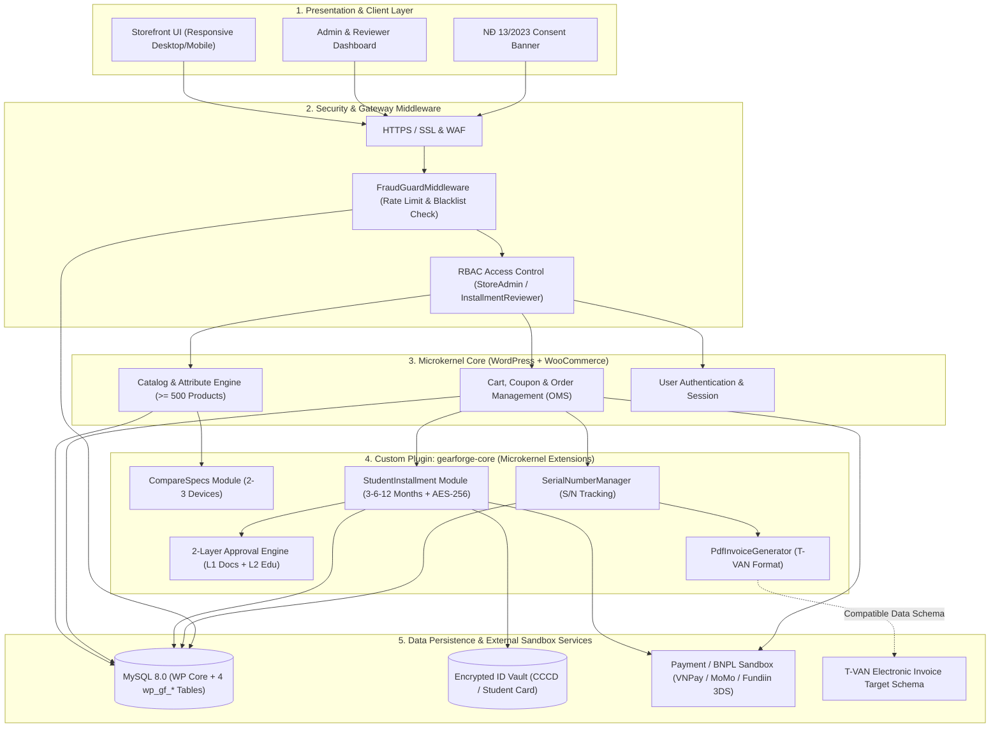
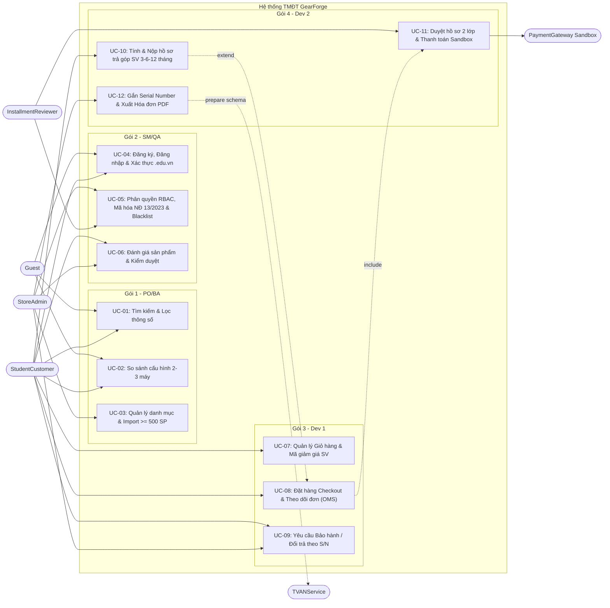
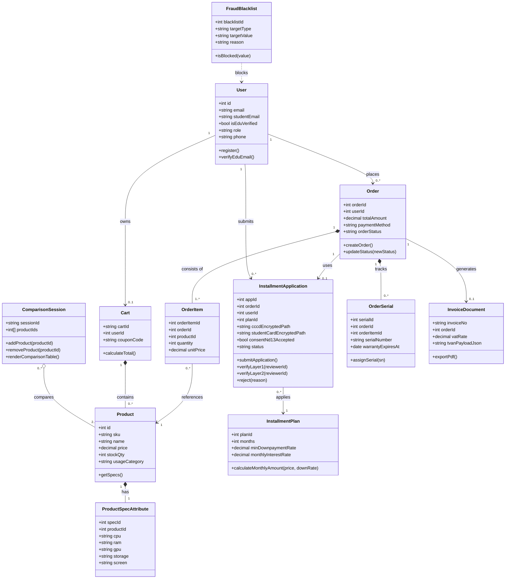
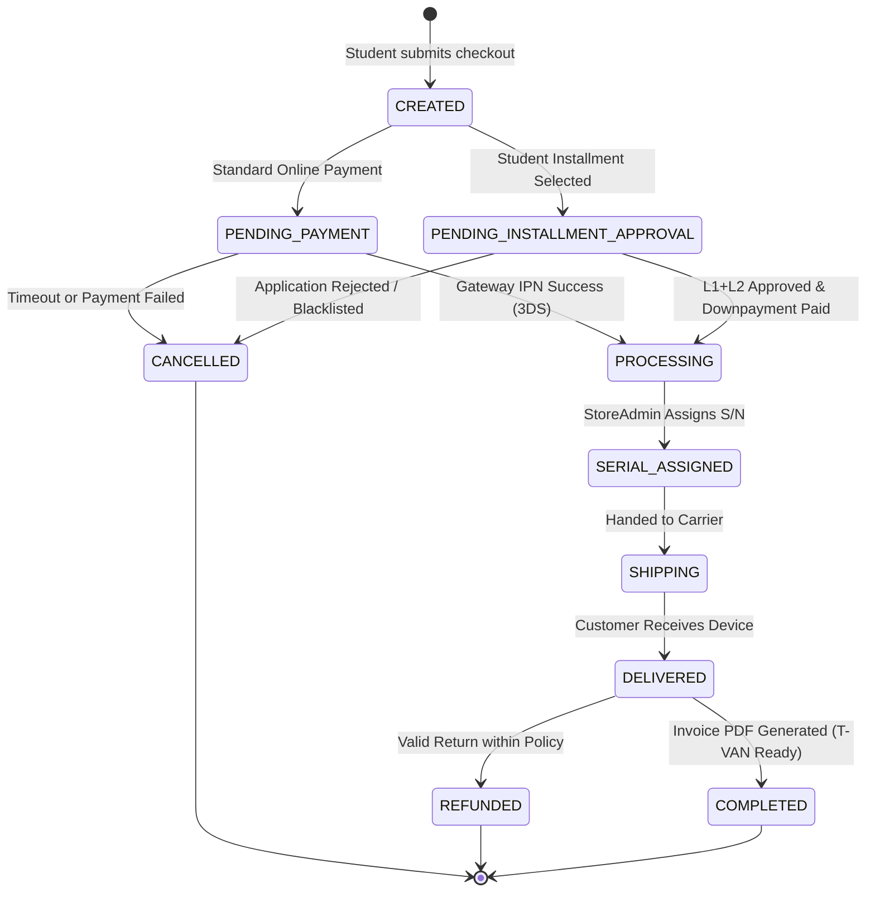
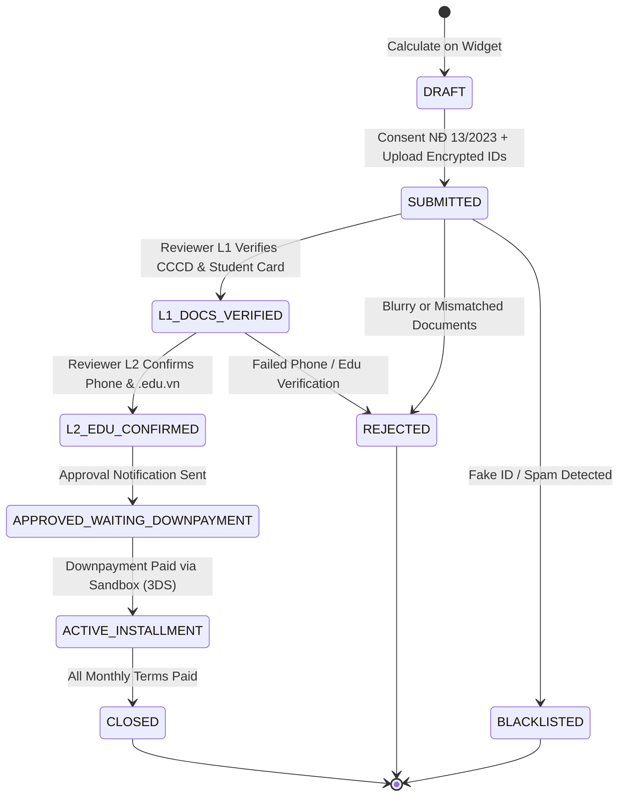
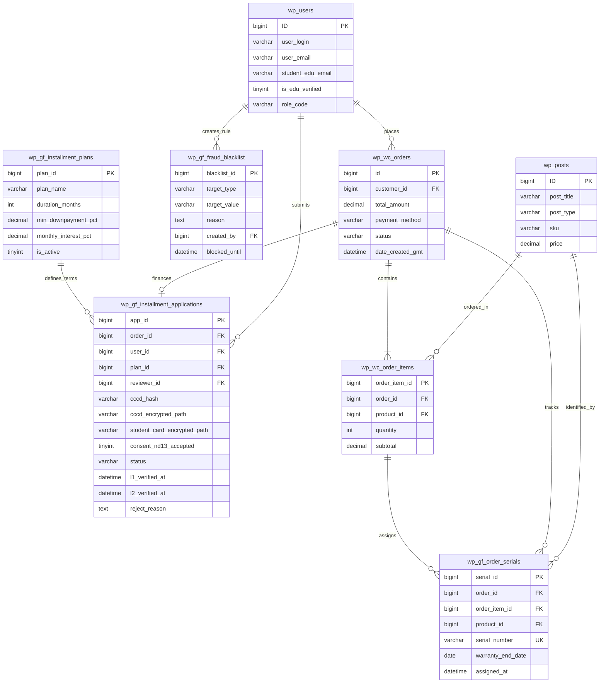
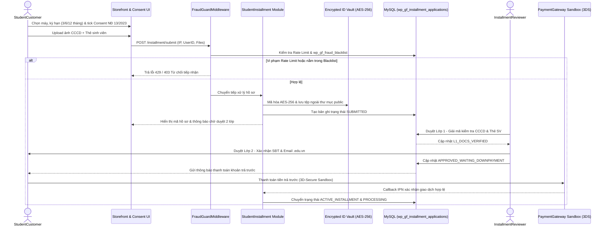
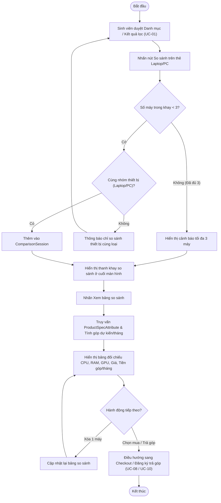

# KHUNG KIẾN TRÚC & SƠ ĐỒ UML / ERD CHUẨN HÓA (GEARFORGE)

> Tài liệu này cung cấp **bộ khung sơ đồ Mermaid chuẩn hóa** bám sát 100% các thuật ngữ trong `2. Quy ước và Sơ đồ UML/Từ điển thuật ngữ và Ma trận Fit-Gap.md`.
> - **Cách sử dụng:** Các thành viên có thể render trực tiếp trên VS Code / GitHub / Mermaid Live Editor (mermaid.live) hoặc chuyển đổi sang PlantUML / Draw.io để xuất ảnh `.png` nét cao chèn vào Báo cáo Word (`EC312`).

---

## 1. SƠ ĐỒ KIẾN TRÚC HỆ THỐNG (SYSTEM ARCHITECTURE – LAYERED + MICROKERNEL)

Mô hình kết hợp **Layered Architecture** (Client → Application → Core & Plugin → Data/External Services) và **Microkernel (Plugin-based)** trên nền tảng WordPress/WooCommerce.

---

## 2. BIỂU ĐỒ USE CASE TỔNG THỂ (MASTER USE CASE OVERVIEW)

*(Role 1 chủ trì hoàn thiện sơ đồ này bằng PlantUML/Draw.io kèm đường `<<include>>` / `<<extend>>` chi tiết trước khi đưa vào Chương 3.2)*

---

## 3. BIỂU ĐỒ LỚP TỔNG THỂ (CLASS DIAGRAM – ROLE 2 CHỦ TRÌ)

---

## 4. BIỂU ĐỒ TRẠNG THÁI (STATE MACHINE DIAGRAMS – ROLE 2 CHỦ TRÌ)

### 4.1. Vòng đời Đơn hàng (`OrderStatus`)

### 4.2. Vòng đời Hồ sơ Trả góp Sinh viên (`InstallmentApplicationStatus`)

---

## 5. MÔ HÌNH THỰC THỂ KẾT HỢP (ERD – ROLE 4 CHỦ TRÌ)

---

## 6. MẪU SEQUENCE & ACTIVITY DIAGRAM CHUẨN CHO 4 GÓI CÔNG VIỆC

### 6.1. Mẫu Sequence Diagram – Gói Role 4: Nộp hồ sơ trả góp SV & Duyệt 2 lớp (`UC-10` & `UC-11`)

### 6.2. Mẫu Activity Diagram – Gói Role 1: So sánh cấu hình 2–3 Laptop/PC (`UC-02`)

