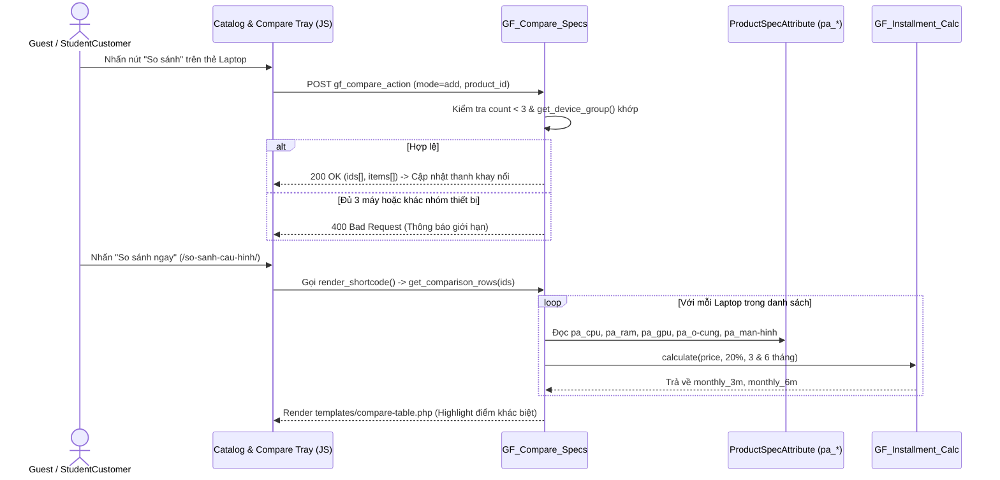

# BẢN NHÁP BÁO CÁO ROLE 1 – PO/BA, KHẢO SÁT & ĐẶC TẢ USE CASE `UC-02 ★`

> **Phụ trách:** Role 1 – Product Owner (PO) / Business Analyst (BA)  
> **Nhánh Git:** `role1-data-catalog`  
> **Phạm vi đóng góp vào Báo cáo Master (`Khung báo cáo đồ án EC312 GearForge.docx`):**  
> - **Chương 1 & Chương 2 (2.1–2.4):** Lý do chọn đề tài, KPIs, Khảo sát ĐHQG, FR/NFR, TCO, Fit-Gap & Pháp lý  
> - **Mục 3.1 & 3.4:** Biểu đồ Use Case tổng thể (`UC-01..12`), Đặc tả `UC-02 ★`, Activity & Sequence Diagram `UC-02`  
> - **Mục 5.2.1 & 6.1–6.2:** Minh chứng 520 sản phẩm & đối sánh mô hình GearForge

---

## MỤC 3.4: PHÂN TÍCH & MÔ HÌNH HÓA PHÂN HỆ TÌM KIẾM, BỘ LỌC & SO SÁNH CẤU HÌNH (`UC-01`, `UC-02 ★`, `UC-03`)

### 1. Bảng Đặc tả Chi tiết Custom Use Case `UC-02 ★` (Chuẩn 6 mục `trinhtin/ec312`)

| Mục | Nội dung đặc tả chi tiết |
| :--- | :--- |
| **1. Thông tin định danh (Metadata)** | - **Use Case ID:** `UC-02 ★` - **Use Case Name:** So sánh cấu hình 2–3 Laptop/PC (Compare Specs) - **Phân loại:** **Functional Gap (`gearforge-core`)** — Mở rộng trên dữ liệu Catalog WooCommerce (520 sản phẩm tại `data/products_import.csv`), tự code `GF_Compare_Specs` kết hợp `GF_Installment_Calc` để hiển thị thêm mức trả góp sinh viên dự kiến/tháng. - **Tác nhân chính (Primary Actor):** `Guest`, `StudentCustomer` - **Liên kết Yêu cầu:** `FR-02`, `NFR-01`, `NFR-04` |
| **2. Tiền điều kiện & Hậu điều kiện (Pre/Post-conditions)** | - **Tiền điều kiện (Pre-conditions):**   1. Hệ thống đã import ≥ 500 sản phẩm (`260 Laptop`, `110 PC nguyên bộ`, `150 Phụ kiện`) kèm các thuộc tính toàn cục `pa_nhu-cau`, `pa_cpu`, `pa_ram`, `pa_gpu`, `pa_o-cung`, `pa_man-hinh`, `pa_trong-luong`, `pa_bao-hanh`.   2. Người dùng đang xem danh sách sản phẩm (`UC-01`) hoặc trang chi tiết sản phẩm. - **Hậu điều kiện (Post-conditions):**   - Danh sách tối đa 3 sản phẩm cùng nhóm thiết bị được lưu trong cookie phiên `gf_compare_ids`.   - Bảng đối chiếu trực quan hiển thị đủ 8 thông số kỹ thuật, tô sáng điểm khác biệt giữa các máy và kèm ước tính trả góp 0% (3 tháng) / 6 tháng. |
| **3. Luồng sự kiện chính (Main Flow / Happy Path)** | 1. Người dùng duyệt danh mục hoặc lọc theo thông số (`UC-01`). 2. Nhấn nút **"+ So sánh"** trên tối đa 3 mẫu Laptop (hoặc PC) cùng loại. 3. Hệ thống gọi `admin-ajax.php?action=gf_compare_action` (`mode=add`), kiểm tra số lượng `< 3` và cùng nhóm thiết bị (`laptop` hoặc `pc`), cập nhật thanh khay so sánh nổi ở cuối màn hình. 4. Người dùng nhấn **So sánh ngay** để mở trang `/so-sanh-cau-hinh/` (`[gearforge_compare]`). 5. `GF_Compare_Specs::get_comparison_rows()` truy vấn thuộc tính `pa_*` và gọi `GF_Installment_Calc::calculate($price, 20, 3|6)` cho từng máy. 6. Hệ thống hiển thị bảng đối chiếu ngang, làm nổi bật các hàng thông số có giá trị khác nhau (`.gf-spec-diff`) và nút chuyển thẳng sang *"Tính trả góp SV"* (`UC-10`) hoặc *"Mua ngay"* (`UC-08`). |
| **4. Luồng thay thế & Ngoại lệ (Alternative / Exception Flows)** | - **EF-01 (Chọn vượt quá 3 sản phẩm – `TC-04`):** Khi khay đã đủ 3 máy và người dùng bấm thêm máy thứ 4, Backend trả về HTTP `400` kèm thông báo *"Khay so sánh tối đa 3 sản phẩm. Vui lòng xóa bớt 1 máy trước khi thêm"*. - **EF-02 (Chọn khác nhóm thiết bị):** Nếu khay đang chứa Laptop và người dùng bấm thêm Phụ kiện/PC, `GF_Compare_Specs::get_device_group()` phát hiện khác nhóm và trả về HTTP `400` chặn trộn bảng. - **AF-01 (Xóa bớt máy hoặc xóa hết):** Người dùng bấm nút `×` trên cột máy hoặc *"Xóa tất cả"* để cập nhật lại bảng ngay lập tức. |
| **5. Yêu cầu Dữ liệu & Giao diện (Data & UI Specs)** | - **Dữ liệu đầu vào:** Cookie `gf_compare_ids` (tối đa 3 `product_id` số nguyên). - **Thuộc tính bắt buộc:** `Nhu cầu`, `CPU`, `RAM`, `GPU`, `Ổ cứng`, `Màn hình`, `Trọng lượng`, `Bảo hành`. - **Giao diện (`NFR-04`):** Bảng nằm trong vùng cuộn ngang `.gf-compare-scroll` để trên màn hình Mobile `375px` người dùng trượt xem từng cột mà không làm tràn khung trang web. |
| **6. Tiêu chí nghiệm thu (Acceptance Criteria – Chuẩn BDD)** | - **Scenario 1 (`TC-03` – So sánh 3 Laptop + Góp SV):**   `Given` người dùng đã chọn 3 mẫu Laptop thuộc nhóm Laptop   `When` mở trang `/so-sanh-cau-hinh/`   `Then` bảng hiển thị đủ 3 cột kèm giá bán, tiền góp SV 0% (3 tháng), góp 6 tháng và tô màu vàng nhạt ở các dòng cấu hình khác biệt. - **Scenario 2 (`TC-04` – Chặn máy thứ 4 & Khác nhóm):**   `Given` khay so sánh đã có 3 Laptop   `When` người dùng bấm nút So sánh trên Laptop thứ 4 hoặc 1 Chuột Gaming   `Then` hệ thống trả về mã `400`, giữ nguyên 3 máy cũ và hiển thị thông báo rõ ràng. |

---

### 2. Biểu đồ Trình tự (`Sequence Diagram – UC-02`)

