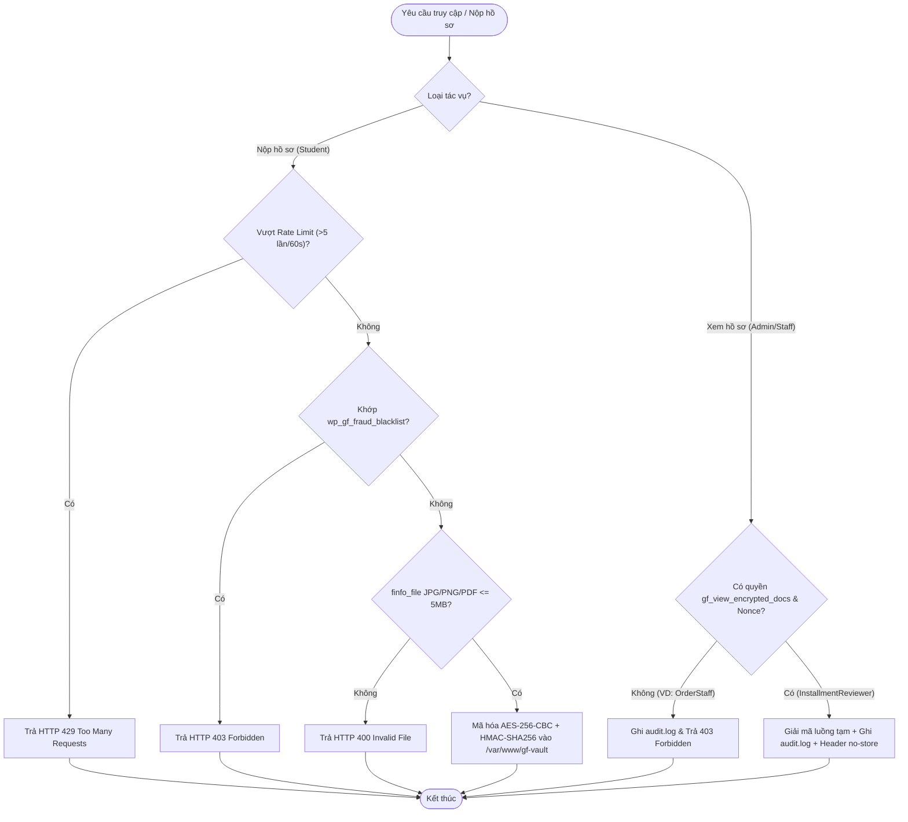
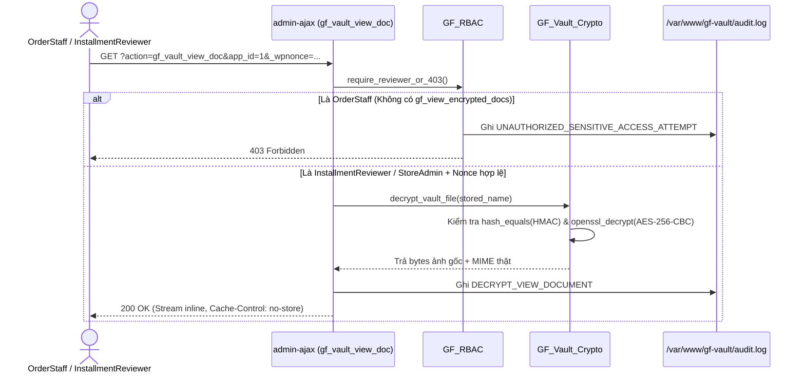

# BẢN NHÁP BÁO CÁO ROLE 2 – SM, KIẾN TRÚC, BẢO MẬT & ĐẶC TẢ USE CASE `UC-05 ★`

> **Phụ trách:** Role 2 – Scrum Master (SM) / System Architect / Security & QA Lead  
> **Nhánh Git:** `role2-security-qa`  
> **Phạm vi đóng góp vào Báo cáo Master (`Khung báo cáo đồ án EC312 GearForge.docx`):**  
> - **Mục 3.2, 3.3, 3.5:** Class Diagram tổng thể, State Machine Diagrams (`OrderStatus` & `InstallmentApplicationStatus`), Đặc tả `UC-05 ★`  
> - **Mục 4.1, 5.1, 5.2.2, 5.3:** Kiến trúc Hệ thống, Môi trường Docker, Minh chứng RBAC/Blacklist & Báo cáo 16 Test Cases  
> - **Phụ lục B:** Nhật ký làm việc nhóm Scrum

---

## MỤC 3.5: PHÂN TÍCH & MÔ HÌNH HÓA PHÂN HỆ PHÂN QUYỀN RBAC, BẢO MẬT NĐ 13/2023 & CHỐNG GIAN LẬN (`UC-04`, `UC-05 ★`, `UC-06`)

### 1. Bảng Đặc tả Chi tiết Custom Use Case `UC-05 ★` (Chuẩn 6 mục `trinhtin/ec312`)

| Mục | Nội dung đặc tả chi tiết |
| :--- | :--- |
| **1. Thông tin định danh (Metadata)** | - **Use Case ID:** `UC-05 ★` - **Use Case Name:** Phân quyền RBAC, Mã hóa dữ liệu nhạy cảm NĐ 13/2023 & Kiểm soát gian lận (Rate Limit / Blacklist) - **Phân loại:** **Functional & Security Gap (`gearforge-core`)** — Gồm `GF_RBAC`, `GF_Fraud_Guard` và `GF_Vault_Crypto`. - **Tác nhân chính (Primary Actor):** `StoreAdmin`, `InstallmentReviewer` - **Tác nhân bị kiểm soát:** `OrderStaff`, `StudentCustomer`, `Guest` - **Liên kết Yêu cầu:** `FR-05`, `NFR-02`, `NFR-03` |
| **2. Tiền điều kiện & Hậu điều kiện (Pre/Post-conditions)** | - **Tiền điều kiện (Pre-conditions):**   1. Plugin `gearforge-core` đã được kích hoạt, đăng ký xong Role `installment_reviewer` (`InstallmentReviewer`) và `order_staff` (`OrderStaff`) cùng các Capability `gf_review_installments`, `gf_view_encrypted_docs`, `gf_assign_serial`, `gf_manage_blacklist`.   2. Biến môi trường `GF_VAULT_ENCRYPTION_KEY` (64 hex chars / 32 bytes AES-256) và `GF_VAULT_DIR=/var/www/gf-vault` đã cấu hình trong `.env`. - **Hậu điều kiện (Post-conditions):**   - Hồ sơ CCCD/Thẻ SV được mã hóa AES-256-CBC + HMAC-SHA256 ngoài webroot, không truy cập được qua URL tĩnh.   - Nhân viên thường (`OrderStaff`) bị chặn `403 Forbidden` khi cố mở hồ sơ định danh.   - Mọi yêu cầu spam vượt ngưỡng nhận HTTP `429`; đối tượng trong `wp_gf_fraud_blacklist` bị chặn `403`. |
| **3. Luồng sự kiện chính (Main Flow / Happy Path)** | 1. Khi `StudentCustomer` nộp hồ sơ trả góp (`UC-10`), `GF_Fraud_Guard::check_rate_limit()` kiểm tra số lượt gửi theo IP & User ID trong cửa sổ 60 giây. 2. `GF_Fraud_Guard::check_blacklist()` đối chiếu `IP`, `USER`, `PHONE`, `CCCD_HASH` với bảng `wp_gf_fraud_blacklist` (còn hiệu lực). 3. Khi hợp lệ, `GF_Vault_Crypto::encrypt_and_store_upload()` dùng `finfo_file` kiểm tra MIME thật (`JPG/PNG/PDF ≤ 5MB`), sinh IV ngẫu nhiên 16 byte, mã hóa `AES-256-CBC` + ký `HMAC-SHA256`, lưu vào `/var/www/gf-vault/<prefix>_<uuid>.enc` (ngoài `/var/www/html`). 4. Khi `InstallmentReviewer` mở màn hình `GearForge Ops → Duyệt Trả Góp 2 Lớp` và bấm *"Giải mã xem CCCD/Thẻ SV"*, endpoint `admin-ajax.php?action=gf_vault_view_doc` kiểm tra `GF_RBAC::require_reviewer_or_403()` + Nonce `gf_vault_view`. 5. Hệ thống xác thực HMAC, giải mã luồng ảnh tạm thời (`Cache-Control: no-store`), trả về trình duyệt và ghi 1 dòng JSON vào `/var/www/gf-vault/audit.log`. |
| **4. Luồng thay thế & Ngoại lệ (Alternative / Exception Flows)** | - **EF-01 (Tài khoản không đủ quyền – `TC-07`):** Nếu `OrderStaff` (`staff_test`) hoặc khách chưa đăng nhập truy cập `gf_vault_view_doc` hoặc tab duyệt trả góp, hệ thống từ chối `403 Forbidden` và ghi sự kiện `UNAUTHORIZED_SENSITIVE_ACCESS_ATTEMPT` vào `audit.log`. - **EF-02 (Truy cập URL trực tiếp tệp Vault – `TC-06`):** Do `/var/www/gf-vault` nằm ngoài DocumentRoot `/var/www/html` (cộng thêm `.htaccess Deny from all`), mọi truy vấn HTTP trực tiếp trả về `404/403`. - **EF-03 (Vượt Rate Limit hoặc dính Blacklist – `TC-08`):** `GF_Fraud_Guard` trả về HTTP `429 Too Many Requests` hoặc `403 Forbidden`. - **AF-01 (Quản trị Blacklist):** `StoreAdmin` có thể thêm/gỡ đối tượng (`IP/PHONE/USER/CCCD_HASH`) tại tab *Danh sách đen Fraud* hoặc tích hợp trực tiếp khi bấm *"Từ chối + Blacklist"*. |
| **5. Yêu cầu Dữ liệu & Giao diện (Data, RBAC & UI Specs)** | - **Ma trận RBAC:** `InstallmentReviewer` có `gf_review_installments` + `gf_view_encrypted_docs`; `OrderStaff` chỉ có `gf_assign_serial` + `edit_shop_orders`; `StoreAdmin` có toàn quyền. - **Cấu trúc tệp mã hóa:** `[16-byte IV][32-byte HMAC-SHA256][AES-256-CBC Ciphertext]` lưu tại `GF_VAULT_DIR`. - **Bảng DB:** `wp_gf_fraud_blacklist` (`blacklist_id`, `target_type`, `target_value`, `reason`, `created_by`, `blocked_until`). |
| **6. Tiêu chí nghiệm thu (Acceptance Criteria – Chuẩn BDD)** | - **Scenario 1 (`TC-06` – Bảo mật file ngoài Webroot & AES-256):**   `Given` ảnh CCCD vừa được upload qua luồng trả góp   `When` kiểm tra thư mục `/var/www/gf-vault/` và truy cập HTTP `/gf-vault/...`   `Then` nội dung tệp `.enc` trên đĩa khác hoàn toàn byte gốc (đã mã hóa AES-256-CBC) và URL HTTP công khai trả về `404/403`. - **Scenario 2 (`TC-07` – Chặn `OrderStaff`):**   `Given` đang đăng nhập bằng tài khoản `staff_test` (`OrderStaff`)   `When` mở endpoint `gf_vault_view_doc`   `Then` hệ thống trả về HTTP `403 Forbidden` và ghi log cảnh báo. - **Scenario 3 (`TC-08` – Rate Limit & Blacklist):**   `Given` gửi liên tiếp quá 5 lần trong 60 giây hoặc dùng SĐT có trong `wp_gf_fraud_blacklist`   `When` nộp hồ sơ trả góp mới   `Then` hệ thống chặn với mã `429` hoặc `403`. |

---

### 2. Biểu đồ Hoạt động & Trình tự (`Activity` & `Sequence Diagram – UC-05`)

