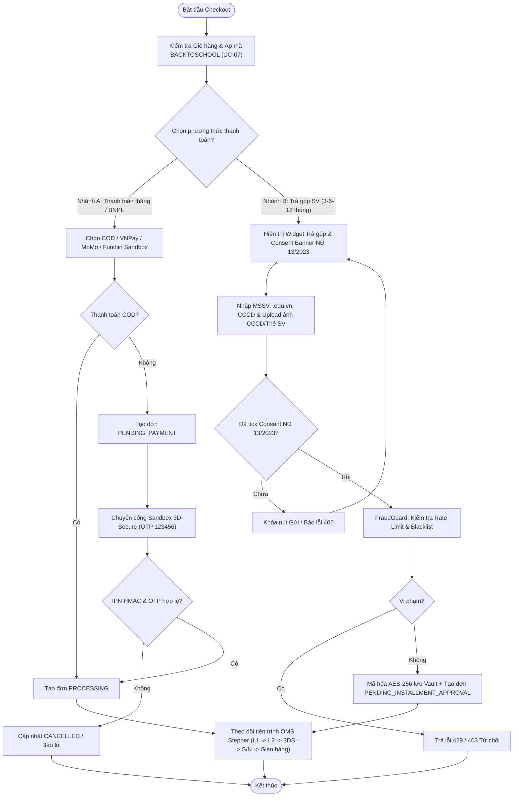
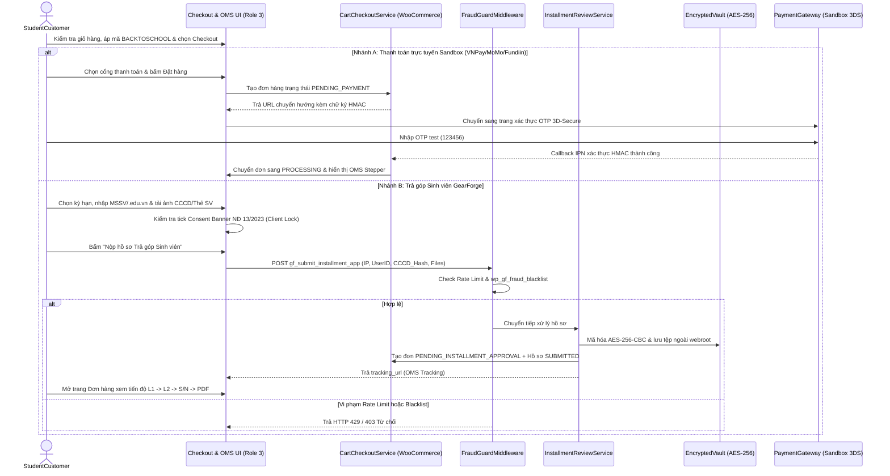
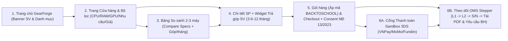

# BẢN NHÁP BÁO CÁO ROLE 3 – UI/UX DESIGN & ĐẶC TẢ USE CASE `UC-08 ★`

> **Phụ trách:** Role 3 – Developer 1 (UI/UX Designer & Frontend WooCommerce Specialist)  
> **Nhánh Git:** `role3-ui-frontend`  
> **Phạm vi đóng góp vào Báo cáo Master (`Khung báo cáo đồ án EC312 GearForge.docx`):**  
> - **Mục 3.6:** Đặc tả chi tiết `UC-08 ★`, Activity Diagram `UC-08` & Sequence Diagram `UC-08`  
> - **Mục 4.3:** User Flow (Sitemap), Tiêu chuẩn Responsive (`NFR-04`) & Thiết kế 6 màn hình Figma  
> - **Mục 5.2.1 & 5.2.3:** Minh chứng giao diện chạy thực tế (Compare Specs, Consent Banner NĐ 13/2023 & OMS Stepper)

---

## PHẦN A (MỤC 3.6): PHÂN TÍCH & MÔ HÌNH HÓA PHÂN HỆ GIỎ HÀNG, CHECKOUT & OMS (`UC-07`, `UC-08 ★`, `UC-09`)

### 1. Bảng Đặc tả Chi tiết Custom Use Case `UC-08 ★` (Chuẩn 6 mục `trinhtin/ec312`)

| Mục | Nội dung đặc tả chi tiết |
| :--- | :--- |
| **1. Thông tin định danh (Metadata)** | - **Use Case ID:** `UC-08 ★` - **Use Case Name:** Đặt hàng trực tuyến (Checkout) & Theo dõi trạng thái đơn hàng (OMS) - **Phân loại:** **Hybrid (`Out-of-the-box` + `Integration/Functional Gap`)** — Giữ lõi WooCommerce Cart/Checkout và mở rộng luồng Trả góp Sinh viên (Consent NĐ 13/2023) + Thanh toán Sandbox 3DS + Thanh tiến trình OMS Stepper (`templates/oms-tracking-stepper.php`). - **Tác nhân chính (Primary Actor):** `StudentCustomer` - **Tác nhân phụ (Secondary Actors):** `PaymentGateway` (VNPay / MoMo / Fundiin Sandbox), `InstallmentReviewer`, `StoreAdmin` - **Liên kết Yêu cầu:** `FR-06`, `FR-07`, `NFR-01`, `NFR-02`, `NFR-04` |
| **2. Tiền điều kiện & Hậu điều kiện (Pre/Post-conditions)** | - **Tiền điều kiện (Pre-conditions):**   1. `StudentCustomer` đã đăng nhập tài khoản hợp lệ.   2. Giỏ hàng có tối thiểu 1 sản phẩm còn tồn kho (`Stock > 0`) hoặc người dùng bấm *Trả góp SV* từ trang chi tiết sản phẩm.   3. Nếu chọn nhánh Trả góp Sinh viên, tài khoản không nằm trong `wp_gf_fraud_blacklist` và chưa vượt ngưỡng `Rate Limiting`. - **Hậu điều kiện (Post-conditions):**   - *Nhánh thanh toán thẳng:* Đơn hàng được lưu vào `wp_wc_orders` ở trạng thái `PENDING_PAYMENT` → chuyển sang `PROCESSING` sau khi nhận IPN Sandbox 3DS thành công.   - *Nhánh trả góp sinh viên:* Đơn hàng ở trạng thái `PENDING_INSTALLMENT_APPROVAL`, hồ sơ lưu tại `wp_gf_installment_applications` (`SUBMITTED`, `consent_nd13_accepted = 1`), ảnh CCCD & Thẻ SV được mã hóa AES-256-CBC tại `/var/www/gf-vault/` và trang OMS hiển thị đầy đủ tiến trình duyệt 2 lớp. |
| **3. Luồng sự kiện chính (Main Flow / Happy Path)** | 1. `StudentCustomer` kiểm tra giỏ hàng (`UC-07`), có thể nhập mã khuyến mãi sinh viên `BACKTOSCHOOL` rồi nhấn **Tiến hành đặt hàng (Checkout)**. 2. Hệ thống hiển thị trang Checkout gồm thông tin giao nhận (KTX ĐHQG / Địa chỉ riêng) và 2 nhánh phương thức:    - **Nhánh A (Thanh toán thẳng / BNPL):** COD, VNPay-QR, Ví MoMo, Fundiin Sandbox.    - **Nhánh B (Trả góp Sinh viên GearForge 3–6–12 tháng):** Mở khung `templates/installment-widget.php`. 3. *(Theo Nhánh B)* Sinh viên chọn tỷ lệ trả trước (`20% / 30% / 50%`) và kỳ hạn (`3 / 6 / 12 tháng`); hệ thống gọi `GET /wp-json/gearforge/v1/installment-calc` hiển thị số tiền trả trước và góp hàng tháng. 4. Sinh viên nhập MSSV, Email `.edu.vn`, số CCCD (12 số), SĐT, tải lên ảnh CCCD & Thẻ sinh viên. 5. Sinh viên đọc **Thông báo Xử lý Dữ liệu Cá nhân (Nghị định 13/2023/NĐ-CP)** và tick chọn ô đồng ý (khi đó nút *"Nộp hồ sơ"* mới được kích hoạt). 6. Hệ thống gọi `FraudGuardMiddleware` kiểm tra Rate Limit & Blacklist → Mã hóa AES-256-CBC lưu tệp vào Vault → Tạo đơn hàng `PENDING_INSTALLMENT_APPROVAL` và hồ sơ `SUBMITTED`. 7. Sinh viên truy cập mục **Đơn hàng của tôi** (`templates/oms-tracking-stepper.php`) để theo dõi thanh tiến trình 7 bước (`CREATED` → `PENDING_INSTALLMENT_APPROVAL` → `PROCESSING` → `SERIAL_ASSIGNED` → `SHIPPING` → `DELIVERED` → `COMPLETED`) cùng tiến độ Duyệt Lớp 1 → Duyệt Lớp 2 → Thanh toán trả trước 3DS → Xem mã `S/N` và tải Hóa đơn PDF. |
| **4. Luồng thay thế & Ngoại lệ (Alternative / Exception Flows)** | - **AF-01 (Chọn Nhánh A – Thanh toán thẳng Sandbox):** Tại bước 2, sinh viên chọn `VNPay / MoMo / Fundiin Sandbox`, bấm Đặt hàng → Hệ thống chuyển hướng sang màn hình xác thực 3D-Secure (`gf_sandbox_3ds=1`), nhập OTP test `123456` → Callback HMAC IPN chuyển đơn sang `PROCESSING`. - **EF-01 (Chưa tick Consent NĐ 13/2023 – `TC-05`):** Tại bước 5, nếu bỏ trống checkbox đồng ý, JS khóa nút Gửi; nếu gửi trực tiếp qua API thiếu `consent_nd13_accepted=1`, Backend trả về HTTP `400 Bad Request` (`gf_consent_required`). - **EF-02 (Tệp upload sai định dạng hoặc > 5MB):** Backend kiểm tra `finfo_file`; nếu không phải `JPG/PNG/PDF` hoặc vượt `5MB`, từ chối lưu và trả lỗi HTTP `400`. - **EF-03 (Vi phạm Rate Limit / Blacklist – `TC-08`):** `FraudGuardMiddleware` chặn ngay và trả về HTTP `429 Too Many Requests` hoặc `403 Forbidden`. - **EF-04 (Mã khuyến mãi hết hạn / Không đủ điều kiện):** Tại bước 1, WooCommerce giữ nguyên tổng tiền cũ và hiển thị thông báo lý do coupon không hợp lệ. |
| **5. Yêu cầu Dữ liệu & Giao diện (Data, RBAC & UI Specs)** | - **Quy tắc nghiệp vụ:** Mã hóa AES-256-CBC mọi tệp CCCD/Thẻ SV; không lưu đường dẫn tĩnh có thể truy cập qua URL; chỉ `InstallmentReviewer` / `StoreAdmin` được xem hồ sơ; bắt buộc có `Serial Number` trước khi chuyển sang `SHIPPING`. - **Schema & Payload liên quan:**   - REST `GET /wp-json/gearforge/v1/oms-status/{order_id}` trả về `domain_order_status`, `installment_application` (`app_id`, `status`, `downpayment_amount`, `monthly_amount`, `l1_verified_at`, `l2_verified_at`), `serial_numbers[]`.   - Bảng DB: `wp_wc_orders`, `wp_gf_installment_applications`, `wp_gf_order_serials`, `wp_gf_fraud_blacklist`. - **Yêu cầu Giao diện (`NFR-04`):** Hiển thị không tràn ngang trên Mobile `375px`; trên Desktop Stepper nằm ngang 7 cột, trên Mobile tự động chuyển sang danh sách dọc dễ theo dõi. |
| **6. Tiêu chí nghiệm thu (Acceptance Criteria – Chuẩn BDD)** | - **Scenario 1 (`TC-05` – Chặn thiếu Consent NĐ 13/2023):**   `Given` sinh viên đã điền đủ MSSV, `.edu.vn` và chọn ảnh CCCD/Thẻ SV   `When` sinh viên chưa tick checkbox Consent NĐ 13/2023 và thử gửi biểu mẫu   `Then` nút Gửi bị vô hiệu hóa trên giao diện và Backend từ chối với mã `400 (gf_consent_required)`. - **Scenario 2 (`TC-11` – Đồng bộ OMS Stepper):**   `Given` hồ sơ trả góp của đơn hàng `#101` đã qua Duyệt Lớp 1 và Lớp 2 (`APPROVED_WAITING_DOWNPAYMENT`)   `When` sinh viên mở trang chi tiết đơn hàng trên Desktop hoặc Mobile `375px`   `Then` thanh OMS Stepper hiển thị sáng xanh đúng 2 huy hiệu Lớp 1, Lớp 2 kèm nút *"Thanh toán tiền trả trước qua Sandbox 3DS"* mà không vỡ bố cục. - **Scenario 3 (`TC-09` – Mã giảm giá `BACKTOSCHOOL`):**   `Given` trong giỏ hàng có Laptop giá ≥ 10.000.000đ   `When` sinh viên áp dụng mã `BACKTOSCHOOL`   `Then` tổng tiền được giảm đúng giá trị khuyến mãi trước khi chuyển sang bước Checkout. |

---

### 2. Biểu đồ Hoạt động (Activity Diagram – `UC-08`)

---

### 3. Biểu đồ Trình tự (Sequence Diagram – `UC-08`)

---

## PHẦN B (MỤC 4.3): THIẾT KẾ UI/UX, USER FLOW & DANH MỤC MÀN HÌNH

### 1. Sơ đồ Luồng người dùng (User Flow / Sitemap – Mục 4.3.1)

### 2. Bảng đối chiếu 6 Khung màn hình Thiết kế (Figma & Hiện thực Code)

| STT | Tên Frame Figma chuẩn | File Code Hiện thực (Role 3) | Thành phần UI trọng tâm |
| :-: | :--- | :--- | :--- |
| **1** | `[UC-01] Home_Category_Filter` | `themes/gearforge-child/style.css`, `functions.php` | Hero Banner ĐHQG, Header Navy `#0F2942`, Card thông số tóm tắt + badge *Góp SV*, nút *So sánh*. |
| **2** | `[UC-02] Compare_Specs_3Devices` | `templates/compare-table.php`, Floating Tray JS | Khay so sánh nổi ở đáy màn hình, bảng đối chiếu 3 máy highlight khác biệt & dòng *Trả góp SV 0%*. |
| **3** | `[UC-10] ProductDetail_InstallmentWidget` | `templates/installment-widget.php` | Chọn Trả trước `20/30/50%` & Kỳ hạn `3/6/12 tháng`, tính ngay tiền góp hàng tháng qua REST API. |
| **4** | `[UC-08] Cart_Checkout_ConsentND13` | `templates/installment-widget.php`, `gearforge-frontend.js` | Khung **Consent Banner NĐ 13/2023** viền vàng cảnh báo rõ ràng, khóa cứng nút gửi nếu chưa tick đồng ý. |
| **5** | `[UC-08] OMS_OrderTracking` | `templates/oms-tracking-stepper.php` | Thanh tiến trình 7 bước `OrderStatus`, 3 huy hiệu duyệt 2 lớp + 3DS, nút tải Hóa đơn PDF & Form BH theo S/N. |
| **6** | `[UC-11] Admin_Review_Serial` | `admin/class-gf-admin-pages.php` *(phối hợp Role 4)* | Tab *Duyệt Trả Góp 2 Lớp* (nút giải mã Vault + Duyệt L1/L2) và tab *Gắn S/N* xuất kho. |
