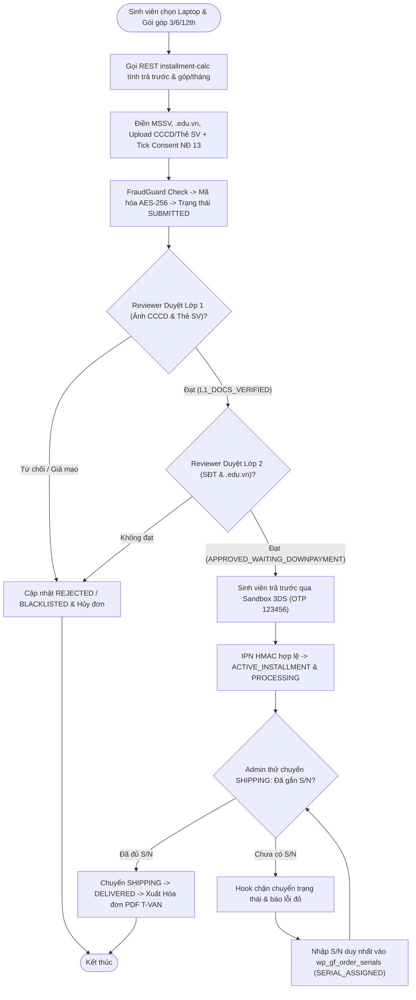

# BẢN NHÁP BÁO CÁO ROLE 4 – BACKEND, DATABASE & ĐẶC TẢ USE CASE `UC-10 ★`

> **Phụ trách:** Role 4 – Developer 2 (Backend, Database & Payment/Installment Engineer)  
> **Nhánh Git:** `role4-backend-payment`  
> **Phạm vi đóng góp vào Báo cáo Master (`Khung báo cáo đồ án EC312 GearForge.docx`):**  
> - **Mục 3.7:** Đặc tả `UC-10 ★`, BPMN/Activity & Sequence Diagram liên thông `UC-10..12`  
> - **Mục 4.2:** Mô hình ERD & Từ điển dữ liệu chi tiết 4 bảng mở rộng `wp_gf_*`  
> - **Mục 5.2.3–5.2.4 & 6.3:** Minh chứng Plugin Trả góp, Sandbox 3DS, S/N, Hóa đơn PDF T-VAN & Lộ trình nâng cấp

---

## MỤC 3.7: PHÂN TÍCH & MÔ HÌNH HÓA PHÂN HỆ TRẢ GÓP SINH VIÊN, DUYỆT 2 LỚP, S/N & HÓA ĐƠN PDF (`UC-10 ★`, `UC-11`, `UC-12`)

### 1. Bảng Đặc tả Chi tiết Custom Use Case `UC-10 ★` (Chuẩn 6 mục `trinhtin/ec312`)

| Mục | Nội dung đặc tả chi tiết |
| :--- | :--- |
| **1. Thông tin định danh (Metadata)** | - **Use Case ID:** `UC-10 ★` - **Use Case Name:** Tính toán gói trả góp & Nộp hồ sơ trả góp sinh viên (3–6–12 tháng) - **Phân loại:** **100% Custom GAP (`gearforge-core`)** — Bao gồm `GF_Installment_Calc`, `GF_Installment_Review`, `GF_Vault_Crypto`, kết nối tiếp với `UC-11` (`GF_Payment_Sandbox`) và `UC-12` (`GF_Serial_Manager`, `GF_Invoice_PDF`). - **Tác nhân chính (Primary Actor):** `StudentCustomer` - **Tác nhân phụ (Secondary Actors):** `InstallmentReviewer`, `PaymentGateway` (VNPay / MoMo / Fundiin Sandbox) - **Liên kết Yêu cầu:** `FR-08`, `FR-09`, `FR-10`, `NFR-02`, `NFR-03` |
| **2. Tiền điều kiện & Hậu điều kiện (Pre/Post-conditions)** | - **Tiền điều kiện (Pre-conditions):**   1. Bảng `wp_gf_installment_plans` đã được seed đủ 3 gói kỳ hạn: `3 tháng (0%)`, `6 tháng (1.2%/tháng)`, `12 tháng (1.5%/tháng)`, tỷ lệ trả trước tối thiểu `20%`.   2. Sinh viên đã đăng nhập tài khoản, có MSSV, Email trường `.edu.vn` và ảnh CCCD + Thẻ sinh viên hợp lệ. - **Hậu điều kiện (Post-conditions):**   - Tạo đơn hàng WooCommerce ở trạng thái `PENDING_INSTALLMENT_APPROVAL` (`wc-gf-installment`).   - Tạo bản ghi trong `wp_gf_installment_applications` trạng thái `SUBMITTED` kèm `cccd_hash`, `cccd_encrypted_path`, `student_card_encrypted_path`, `consent_nd13_accepted = 1`.   - Mở khóa quy trình `UC-11` (Duyệt Lớp 1 → Duyệt Lớp 2 → Thanh toán trả trước 3D-Secure) và `UC-12` (Gắn `S/N` trước khi `SHIPPING` → Xuất Hóa đơn PDF chuẩn T-VAN). |
| **3. Luồng sự kiện chính (Main Flow / Happy Path)** | 1. Trên trang chi tiết Laptop/PC (`templates/installment-widget.php`), sinh viên chọn tỷ lệ trả trước (`20% / 30% / 50%`) và kỳ hạn (`3 / 6 / 12 tháng`). 2. Hệ thống gọi `GET /wp-json/gearforge/v1/installment-calc?price=P&down_pct=r&months=N` áp dụng công thức:    `D = P × r_down`; `L = P - D`; `I = L × r_int × N`; `M = round((L + I) / N, -3)`. 3. Sinh viên điền MSSV, Email `.edu.vn`, Số CCCD (12 số), SĐT, đính kèm ảnh CCCD + Thẻ SV và tick **Consent Banner NĐ 13/2023**. 4. Hệ thống gọi `GF_Fraud_Guard` (Rate Limit + Blacklist) → `GF_Vault_Crypto` (mã hóa AES-256-CBC) → tạo đơn hàng & lưu hồ sơ `SUBMITTED`. 5. *(Liên thông `UC-11`)* `InstallmentReviewer` mở Admin Ops: bấm **Duyệt Lớp 1** (`L1_DOCS_VERIFIED`) sau khi đối chiếu ảnh CCCD/Thẻ SV, rồi bấm **Duyệt Lớp 2** (`APPROVED_WAITING_DOWNPAYMENT`) sau khi xác nhận SĐT & Email `.edu.vn`. 6. Sinh viên nhấn nút thanh toán trả trước, hoàn tất OTP `123456` trên cổng **Sandbox 3D-Secure** (`gf_sandbox_3ds=1`); IPN hợp lệ chuyển hồ sơ sang `ACTIVE_INSTALLMENT` và đơn sang `PROCESSING`. 7. *(Liên thông `UC-12`)* `StoreAdmin`/`OrderStaff` gắn mã `Serial Number` duy nhất vào `wp_gf_order_serials`, mở khóa chuyển `SHIPPING` và xuất Hóa đơn PDF chuẩn T-VAN (có S/N + VAT 10%). |
| **4. Luồng thay thế & Ngoại lệ (Alternative / Exception Flows)** | - **EF-01 (Chưa tick Consent / Email không phải `.edu.vn` / CCCD không đủ 12 số):** Trả lỗi `400 Bad Request` và không ghi nhận hồ sơ. - **EF-02 (Reviewer cố bấm Duyệt Lớp 2 trước khi Duyệt Lớp 1 – `TC-13`):** `GF_Installment_Review::review_layer_2()` kiểm tra trạng thái phải là `L1_DOCS_VERIFIED`, nếu không trả lỗi `gf_invalid_state`. - **EF-03 (Từ chối / Phát hiện giả mạo):** Reviewer nhập lý do từ chối hoặc chọn *"Từ chối + Blacklist"* → hồ sơ chuyển `REJECTED`/`BLACKLISTED`, đơn hàng hủy và `CCCD_HASH` được ghi vào `wp_gf_fraud_blacklist`. - **EF-04 (Kho cố chuyển đơn Laptop sang `SHIPPING` khi thiếu `S/N` – `TC-15`):** `GF_Serial_Manager::enforce_serial_before_shipping()` chặn và tự động hoàn nguyên trạng thái cũ kèm thông báo đỏ. |
| **5. Yêu cầu Dữ liệu & Giao diện (Data, API & Schema Specs)** | - **REST API (`lab_api_notes.md`):**   - `GET /wp-json/gearforge/v1/installment-calc?price=20000000&down_pct=30&months=6` → `{"downpayment_amount":6000000,"loan_principal":14000000,"total_interest":1008000,"monthly_amount":2501000}`.   - `GET /wp-json/gearforge/v1/oms-status/{order_id}` → Trả trạng thái tổng hợp Order + Hồ sơ trả góp + Mảng S/N. - **4 Bảng MySQL mở rộng:** `wp_gf_installment_plans`, `wp_gf_installment_applications`, `wp_gf_order_serials`, `wp_gf_fraud_blacklist`. |
| **6. Tiêu chí nghiệm thu (Acceptance Criteria – Chuẩn BDD)** | - **Scenario 1 (`TC-12` – Công thức tính trả góp 6 tháng):**   `Given` máy giá `20.000.000đ`, trả trước `30%`, kỳ hạn `6 tháng` (`1.2%/tháng`)   `When` gọi `GET /wp-json/gearforge/v1/installment-calc`   `Then` kết quả trả về `downpayment_amount = 6000000`, `loan_principal = 14000000`, `monthly_amount = 2501000`. - **Scenario 2 (`TC-13` – Tuân tự Duyệt Lớp 1 → Lớp 2):**   `Given` hồ sơ vừa nộp ở trạng thái `SUBMITTED`   `When` Reviewer thử gọi Duyệt Lớp 2 ngay hoặc thực hiện đúng tuần tự Lớp 1 rồi Lớp 2   `Then` gọi nhảy cóc bị chặn (`gf_invalid_state`); thực hiện đúng tuần tự chuyển thành `L1_DOCS_VERIFIED` → `APPROVED_WAITING_DOWNPAYMENT`. - **Scenario 3 (`TC-15` & `TC-16` – Chặn thiếu S/N & Xuất PDF T-VAN):**   `Given` đơn Laptop đã thanh toán trả trước (`PROCESSING`) nhưng chưa nhập S/N   `When` Admin chuyển đơn sang `gf-shipping` trước rồi nhập S/N và tải Hóa đơn PDF   `Then` lần chuyển thiếu S/N bị chặn giữ nguyên trạng thái; sau khi gán S/N thì cho xuất kho và tải được file `%PDF-1.4` chứa đúng S/N + VAT 10%. |

---

### 2. Biểu đồ Hoạt động Liên thông (`Activity / BPMN – UC-10..UC-12`)

