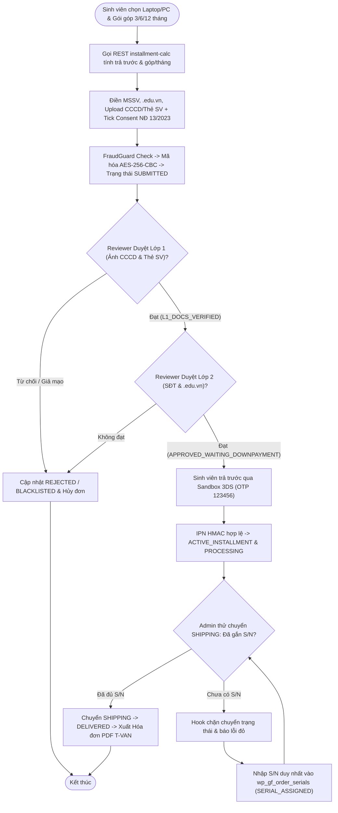
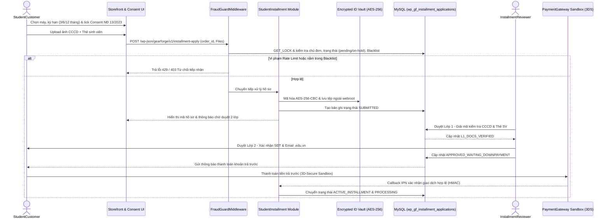
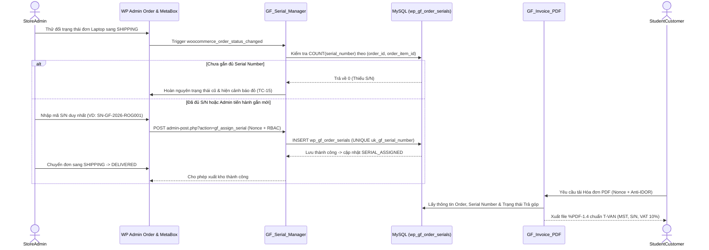
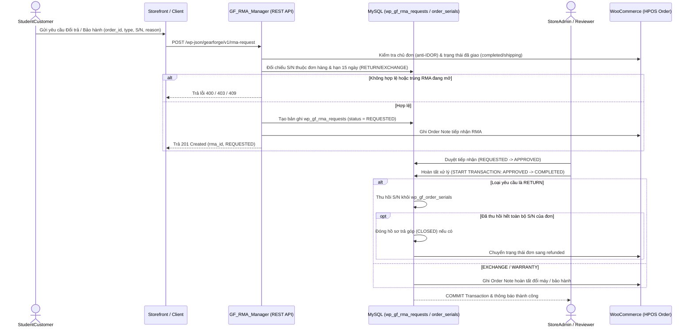
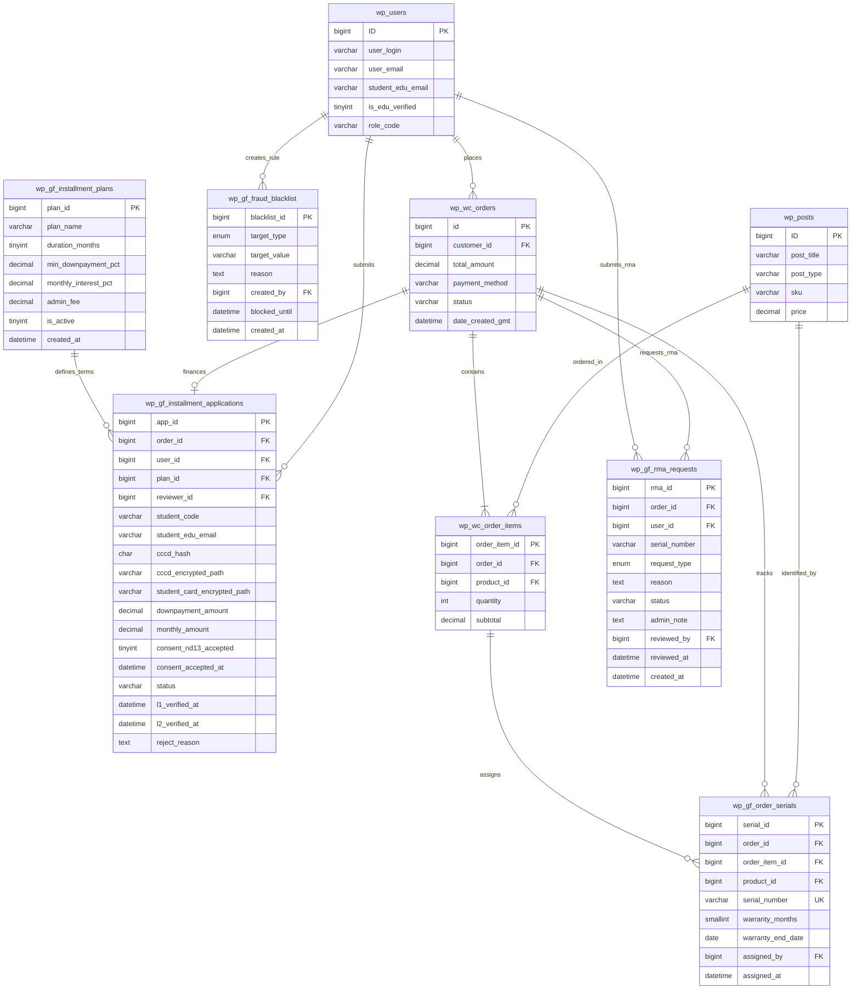
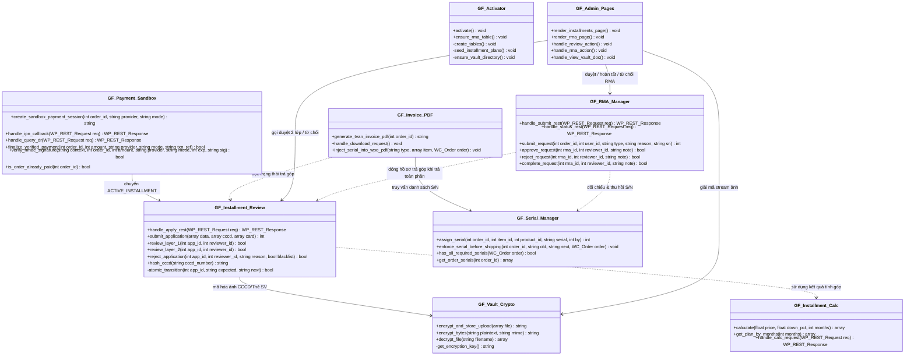

# BẢN NHÁP BÁO CÁO ROLE 4 – BACKEND, DATABASE & ĐẶC TẢ USE CASE `UC-10 ★`

> **Sinh viên thực hiện:** **Lê Lưu Luân** — MSSV: `24521027`  
> **Vai trò Scrum:** Role 4 – Developer 2 (Backend, Database & Payment/Installment Engineer)  
> **Nhánh Git độc quyền:** `role4-backend-payment` *(Issue `#4`)*  
> **Phạm vi đóng góp vào Báo cáo Master (`Khung báo cáo đồ án EC312 GearForge.docx`):**
> - **Mục 3.7:** Đặc tả `UC-10 ★`, BPMN/Activity & Sequence Diagram liên thông `UC-10..12`
> - **Mục 4.2:** Mô hình ERD, Script SQL & Từ điển dữ liệu chi tiết 5 bảng mở rộng `wp_gf_*`
> - **Mục 5.2.3–5.2.5:** Minh chứng Demo Trả góp, Duyệt 2 lớp, Sandbox 3DS, S/N, Hóa đơn PDF T-VAN & Đổi trả RMA *(cập nhật ảnh thực tế từ Docker)*
> - **Mục 6.3:** Giải pháp kỹ thuật & Hướng phát triển tương lai (Out-of-scope Roadmap)

---

## MỤC 3.7: PHÂN TÍCH & MÔ HÌNH HÓA PHÂN HỆ TRẢ GÓP SINH VIÊN, DUYỆT 2 LỚP, S/N & HÓA ĐƠN PDF (`UC-10 ★`, `UC-11`, `UC-12`)

### 3.7.1. Bảng Đặc tả Chi tiết Custom Use Case `UC-10 ★` (Chuẩn 6 mục)

| Mục | Nội dung đặc tả chi tiết |
| :--- | :--- |
| **1. Thông tin định danh (Metadata)** | - **Use Case ID:** `UC-10 ★`<br>- **Use Case Name:** Tính toán gói trả góp & Nộp hồ sơ trả góp sinh viên (3–6–12 tháng)<br>- **Phân loại:** **100% Custom GAP (`gearforge-core`)** — Gồm `InstallmentCalculatorService`, `InstallmentReviewService`, `GF_Vault_Crypto`, kết nối tiếp với `UC-11` (`PaymentGatewayAdapter`) và `UC-12` (`SerialNumberService`, `PdfInvoiceGenerator`).<br>- **Tác nhân chính (Primary Actor):** `StudentCustomer`<br>- **Tác nhân phụ (Secondary Actors):** `InstallmentReviewer`, `PaymentGateway` (VNPay / MoMo / Fundiin Sandbox), `StoreAdmin`, `TVANService`<br>- **Liên kết Yêu cầu:** `FR-08`, `FR-09`, `FR-10`, `NFR-02`, `NFR-03` |
| **2. Tiền điều kiện & Hậu điều kiện (Pre/Post-conditions)** | - **Tiền điều kiện (Pre-conditions):**<br>  1. Bảng `wp_gf_installment_plans` đã được seed đủ 3 gói kỳ hạn: `3 tháng (0%)`, `6 tháng (1.2%/tháng)`, `12 tháng (1.5%/tháng)`, tỷ lệ trả trước tối thiểu `20%`.<br>  2. Sinh viên đã đăng ký/đăng nhập tài khoản, có MSSV, Email trường `.edu.vn` và chuẩn bị ảnh CCCD + Thẻ sinh viên hợp lệ (`JPG/PNG/PDF`, dung lượng ≤ 5MB).<br>- **Hậu điều kiện (Post-conditions):**<br>  - Tạo đơn hàng WooCommerce ở trạng thái `PENDING_INSTALLMENT_APPROVAL`.<br>  - Tạo bản ghi trong `wp_gf_installment_applications` trạng thái `SUBMITTED` kèm `cccd_hash` (HMAC-SHA256 với server pepper), `cccd_encrypted_path`, `student_card_encrypted_path` (mã hóa AES-256-CBC ngoài webroot) và `consent_nd13_accepted = 1`.<br>  - Mở khóa quy trình `UC-11` (Duyệt Lớp 1 $\rightarrow$ Duyệt Lớp 2 $\rightarrow$ Thanh toán trả trước 3D-Secure) và `UC-12` (Gắn `S/N` trước khi `SHIPPING` $\rightarrow$ Xuất Hóa đơn PDF chuẩn T-VAN). |
| **3. Luồng sự kiện chính (Main Flow / Happy Path)** | 1. Trên trang chi tiết Laptop/PC (`installment-widget.php`), sinh viên chọn tỷ lệ trả trước (`20% / 30% / 50%`) và kỳ hạn (`3 / 6 / 12 tháng`).<br>2. Hệ thống gọi `GET /wp-json/gearforge/v1/installment-calc?price=P&down_pct=r&months=N` áp dụng công thức chuẩn:<br>   - Tiền trả trước: $D = P \times r_{\text{down}}$<br>   - Gốc còn lại vay: $L = P - D$<br>   - Tổng lãi cả kỳ hạn: $I = L \times r_{\text{int}} \times N$<br>   - Tiền góp mỗi tháng: $M = \text{round}((L + I) / N, -3)$ *(làm tròn hàng nghìn VNĐ)*.<br>3. Sinh viên điền MSSV, Email `.edu.vn`, Số CCCD (12 số), SĐT, đính kèm ảnh CCCD + Thẻ SV và tick **Consent Banner Nghị định 13/2023/NĐ-CP**.<br>4. Hệ thống gọi `FraudGuardMiddleware` (kiểm tra Rate Limit & `wp_gf_fraud_blacklist`) $\rightarrow$ `GF_Vault_Crypto` (kiểm tra MIME `finfo_file`, mã hóa AES-256-CBC lưu vào `/var/www/gf-vault/`) $\rightarrow$ tạo đơn hàng & lưu hồ sơ `SUBMITTED`.<br>5. *(Liên thông `UC-11`)* `InstallmentReviewer` mở WP Admin: bấm **Duyệt Lớp 1** (`L1_DOCS_VERIFIED`) sau khi giải mã đối chiếu ảnh CCCD/Thẻ SV, rồi bấm **Duyệt Lớp 2** (`APPROVED_WAITING_DOWNPAYMENT`) sau khi xác nhận SĐT & Email `.edu.vn`.<br>6. Sinh viên thực hiện thanh toán khoản tiền trả trước trên cổng **Sandbox 3D-Secure** (`VNPay/MoMo/Fundiin`, OTP test `123456`); Callback IPN xác thực chữ ký HMAC hợp lệ chuyển hồ sơ sang `ACTIVE_INSTALLMENT` và đơn hàng sang `PROCESSING`.<br>7. *(Liên thông `UC-12`)* `StoreAdmin` gắn mã `Serial Number` duy nhất vào `wp_gf_order_serials` (`SERIAL_ASSIGNED`), mở khóa chuyển `SHIPPING` $\rightarrow$ `DELIVERED` $\rightarrow$ xuất Hóa đơn PDF chuẩn T-VAN (hiển thị S/N + VAT 8%–10%). |
| **4. Luồng thay thế & Ngoại lệ (Alternative / Exception Flows)** | - **EF-01 (Thiếu Consent NĐ 13/2023, sai Email `.edu.vn`, CCCD không đủ 12 số hoặc tệp > 5MB / sai MIME):** Hệ thống trả lỗi `400 Bad Request`, hiển thị thông báo chi tiết và không ghi nhận hồ sơ.<br>- **EF-02 (Vi phạm Rate Limit hoặc nằm trong Blacklist):** `FraudGuardMiddleware` chặn ngay và trả `HTTP 429` (cooldown) hoặc `HTTP 403` (Blacklisted).<br>- **EF-03 (Reviewer cố bấm Duyệt Lớp 2 trước khi Duyệt Lớp 1 – `TC-13`):** `InstallmentReviewService` kiểm tra trạng thái phải là `L1_DOCS_VERIFIED`, nếu không trả lỗi `gf_invalid_state` và giữ nguyên trạng thái.<br>- **EF-04 (Từ chối hoặc phát hiện giả mạo):** Reviewer nhập lý do từ chối hoặc chọn *"Từ chối + Blacklist"* $\rightarrow$ hồ sơ chuyển `REJECTED` / `BLACKLISTED`, đơn hàng chuyển `CANCELLED` và `cccd_hash` được ghi vào `wp_gf_fraud_blacklist`.<br>- **EF-05 (Kho cố chuyển đơn Laptop/PC sang `SHIPPING` khi thiếu `S/N` – `TC-15`):** Hook `woocommerce_order_status_changed` chặn chuyển trạng thái, hoàn nguyên trạng thái cũ và báo lỗi đỏ nhắc nhập S/N. |
| **5. Yêu cầu Dữ liệu & Giao diện (Data, API & Schema Specs)** | - **REST API nội bộ (`rest_api_init`):**<br>  - `GET /wp-json/gearforge/v1/installment-calc?price=20000000&down_pct=30&months=6`<br>    Trả về JSON: `{"price":20000000,"down_pct":30,"months":6,"downpayment_amount":6000000,"loan_principal":14000000,"total_interest":1008000,"monthly_amount":2501000}`.<br>  - `POST /wp-json/gearforge/v1/installment-apply`: Nộp hồ sơ trả góp kèm upload 2 ảnh CCCD/Thẻ SV mã hóa AES-256-CBC.<br>  - `GET /wp-json/gearforge/v1/oms-status/{order_id}`: Trả về JSON trạng thái tổng hợp `OrderStatus` + `InstallmentApplicationStatus` + mảng `serial_numbers`.<br>  - `POST /wp-json/gearforge/v1/rma-request` & `GET /wp-json/gearforge/v1/rma-status/{order_id}`: Gửi và tra cứu yêu cầu Đổi trả / Bảo hành (RMA).<br>- **5 Bảng MySQL mở rộng:** `wp_gf_installment_plans`, `wp_gf_installment_applications`, `wp_gf_order_serials`, `wp_gf_fraud_blacklist`, `wp_gf_rma_requests`. |
| **6. Tiêu chí nghiệm thu (Acceptance Criteria – Chuẩn BDD)** | - **Scenario 1 (`TC-12` – Công thức tính trả góp 6 tháng):**<br>  `Given` máy giá `20.000.000đ`, trả trước `30%` (`6.000.000đ`), kỳ hạn `6 tháng` (`1.2%/tháng`)<br>  `When` gọi `GET /wp-json/gearforge/v1/installment-calc`<br>  `Then` trả về `downpayment_amount = 6000000`, `loan_principal = 14000000`, `total_interest = 1008000`, `monthly_amount = 2501000`.<br>- **Scenario 2 (`TC-05` & `TC-06` – Bảo mật NĐ 13/2023):**<br>  `Given` sinh viên nộp hồ sơ không tick Consent hoặc cố truy cập URL trực tiếp file ảnh CCCD<br>  `When` gửi form hoặc mở URL ẩn danh<br>  `Then` form bị chặn khi thiếu Consent; ảnh đã mã hóa AES-256-CBC ngoài webroot không thể truy cập trực tiếp.<br>- **Scenario 3 (`TC-13` – Tuần tự Duyệt Lớp 1 $\rightarrow$ Lớp 2):**<br>  `Given` hồ sơ ở trạng thái `SUBMITTED`<br>  `When` Reviewer thử Duyệt Lớp 2 nhảy cóc, sau đó thực hiện đúng Lớp 1 rồi Lớp 2<br>  `Then` gọi nhảy cóc bị chặn (`gf_invalid_state`); thực hiện đúng tuần tự chuyển thành `L1_DOCS_VERIFIED` $\rightarrow$ `APPROVED_WAITING_DOWNPAYMENT`.<br>- **Scenario 4 (`TC-14`, `TC-15`, `TC-16` – 3DS, Chặn thiếu S/N & PDF T-VAN):**<br>  `Given` hồ sơ đã duyệt trả trước qua Sandbox 3DS (`PROCESSING`) nhưng chưa nhập S/N<br>  `When` Admin chuyển đơn sang `SHIPPING` trước rồi mới gán S/N và xuất Hóa đơn PDF<br>  `Then` lần chuyển thiếu S/N bị chặn; sau khi gán S/N duy nhất vào `wp_gf_order_serials` thì xuất kho thành công và tải được file `.pdf` có đủ S/N + VAT 8%–10%. |

---

### 3.7.2. Biểu đồ Hoạt động Liên thông (`Activity / BPMN – UC-10..UC-12`)

*(File nguồn: `2. Quy ước và Sơ đồ UML/role4_diagrams/UC10_12_Installment_Activity_Role4.mmd`)*



---

### 3.7.3. Biểu đồ Tuần tự (`Sequence Diagram – UC-10 & UC-11`)

*(File nguồn: `2. Quy ước và Sơ đồ UML/role4_diagrams/UC10_11_Installment_Sequence_Role4.mmd`)*



---

### 3.7.4. Biểu đồ Tuần tự Gắn Serial Number & Xuất Hóa đơn PDF T-VAN (`Sequence Diagram – UC-12`)

*(File nguồn: `2. Quy ước và Sơ đồ UML/role4_diagrams/UC12_Serial_Invoice_Sequence_Role4.mmd`)*



---

### 3.7.5. Biểu đồ Tuần tự Đổi trả / Bảo hành (`Sequence Diagram – RMA`)

*(File nguồn: `2. Quy ước và Sơ đồ UML/role4_diagrams/RMA_Sequence_Role4.mmd`)*



---

## MỤC 4.2: THIẾT KẾ CƠ SỞ DỮ LIỆU (DATABASE DESIGN)

### 4.2.1. Mô hình Thực thể Kết hợp (ERD)

Hệ thống áp dụng kiến trúc **mở rộng không xâm lấn (Non-intrusive Extension)** trên nền tảng WordPress / WooCommerce (tương thích chuẩn **HPOS – High-Performance Order Storage**). Thay vì sửa đổi cấu trúc bảng lõi của WooCommerce (`wp_users`, `wp_posts`, `wp_wc_orders`, `wp_wc_order_items`), plugin `gearforge-core` bổ sung **5 bảng quan hệ `wp_gf_*`** liên kết chặt chẽ qua các khóa ngoại (`order_id`, `user_id`, `product_id`, `order_item_id`, `plan_id`):

- `wp_users` (`1`) — (`0..N`) `wp_gf_installment_applications`: Một sinh viên có thể nộp nhiều hồ sơ trả góp (qua các đơn hàng khác nhau).
- `wp_gf_installment_plans` (`1`) — (`0..N`) `wp_gf_installment_applications`: Một gói kỳ hạn áp dụng cho nhiều hồ sơ trả góp.
- `wp_wc_orders` (`1`) — (`0..1`) `wp_gf_installment_applications`: Mỗi đơn hàng trả góp gắn với tối đa một hồ sơ trả góp sinh viên.
- `wp_wc_orders` (`1`) — (`0..N`) `wp_gf_order_serials` và `wp_wc_order_items` (`1`) — (`0..N`) `wp_gf_order_serials`: Một đơn hàng gồm nhiều dòng sản phẩm, mỗi máy xuất kho bắt buộc có bản ghi `serial_number` riêng biệt.
- `wp_users` (`1`) — (`0..N`) `wp_gf_fraud_blacklist`: Ghi nhận quản trị viên (`StoreAdmin` / `InstallmentReviewer`) đã tạo quy tắc chặn gian lận.
- `wp_wc_orders` (`1`) — (`0..N`) `wp_gf_rma_requests` và `wp_users` (`1`) — (`0..N`) `wp_gf_rma_requests`: Lưu yêu cầu đổi trả / bảo hành (RMA) gắn với đơn hàng và `serial_number` thiết bị.

*(File nguồn: `2. Quy ước và Sơ đồ UML/role4_diagrams/ERD_GearForge_Role4.mmd`)*



---

### 4.2.2. Chuẩn hóa & Từ điển dữ liệu (Data Dictionary – 5 bảng mở rộng `wp_gf_*`)

#### Bảng 1: `wp_gf_installment_plans` *(Danh mục gói kỳ hạn trả góp sinh viên)*
Lưu cấu hình các gói trả góp (3 tháng 0%, 6 tháng 1.2%/tháng, 12 tháng 1.5%/tháng).

| Tên trường (Column) | Kiểu dữ liệu (MySQL 8.0) | Khóa / Ràng buộc | Giá trị mặc định | Mô tả ý nghĩa |
| :--- | :--- | :--- | :--- | :--- |
| `plan_id` | `BIGINT UNSIGNED` | `PK`, `AUTO_INCREMENT` | — | Mã định danh duy nhất của gói trả góp. |
| `plan_name` | `VARCHAR(100)` | `NOT NULL` | — | Tên hiển thị gói (VD: *"Gói Sinh viên 0% - 3 tháng"*). |
| `duration_months` | `TINYINT UNSIGNED` | `NOT NULL` | — | Kỳ hạn góp tính theo tháng (`3`, `6`, hoặc `12`). |
| `min_downpayment_pct` | `DECIMAL(5,2)` | `NOT NULL` | `20.00` | Tỷ lệ trả trước tối thiểu (%). |
| `monthly_interest_pct` | `DECIMAL(5,2)` | `NOT NULL` | `0.00` | Lãi suất phẳng hàng tháng (`0.00`, `1.20`, `1.50`). |
| `admin_fee` | `DECIMAL(12,2)` | `NOT NULL` | `0.00` | Phí hồ sơ hành chính (VNĐ, mặc định `0`). |
| `is_active` | `TINYINT(1)` | `NOT NULL` | `1` | Cờ kích hoạt gói (`1`: đang mở, `0`: tạm ẩn). |
| `created_at` | `DATETIME` | `NOT NULL` | `CURRENT_TIMESTAMP` | Thời điểm khởi tạo gói. |

*Dữ liệu seed mặc định khi kích hoạt Plugin:*
1. `plan_id = 1`: `3 tháng`, `min_downpayment_pct = 20.00`, `monthly_interest_pct = 0.00`
2. `plan_id = 2`: `6 tháng`, `min_downpayment_pct = 20.00`, `monthly_interest_pct = 1.20`
3. `plan_id = 3`: `12 tháng`, `min_downpayment_pct = 20.00`, `monthly_interest_pct = 1.50`

---

#### Bảng 2: `wp_gf_installment_applications` *(Hồ sơ đăng ký trả góp sinh viên)*
Lưu thông tin định danh đã mã hóa, kết quả tính toán khoản góp và dấu vết duyệt 2 lớp.

| Tên trường (Column) | Kiểu dữ liệu (MySQL 8.0) | Khóa / Ràng buộc | Giá trị mặc định | Mô tả ý nghĩa |
| :--- | :--- | :--- | :--- | :--- |
| `app_id` | `BIGINT UNSIGNED` | `PK`, `AUTO_INCREMENT` | — | Mã định danh duy nhất của hồ sơ trả góp. |
| `order_id` | `BIGINT UNSIGNED` | `NOT NULL`, `INDEX (idx_gf_app_order)` | — | Liên kết mã đơn hàng WooCommerce (`wp_wc_orders.id`). |
| `user_id` | `BIGINT UNSIGNED` | `NOT NULL`, `INDEX (idx_gf_app_user)` | — | ID tài khoản sinh viên nộp hồ sơ (`wp_users.ID`). |
| `plan_id` | `BIGINT UNSIGNED` | `FK -> wp_gf_installment_plans(plan_id)`, `NOT NULL` | — | Gói kỳ hạn trả góp sinh viên đã chọn. |
| `reviewer_id` | `BIGINT UNSIGNED` | `NULL` | `NULL` | ID của `InstallmentReviewer` xử lý duyệt hồ sơ. |
| `student_code` | `VARCHAR(50)` | `NOT NULL` | — | Mã số sinh viên (MSSV) khai báo trên form. |
| `student_edu_email` | `VARCHAR(150)` | `NOT NULL` | — | Email sinh viên tên miền giáo dục (`.edu.vn` / `.edu`). |
| `cccd_hash` | `CHAR(64)` | `NOT NULL`, `INDEX (idx_gf_app_cccd_hash)` | — | Mã băm **HMAC-SHA256** (kèm server pepper) của số CCCD (dùng đối chiếu Blacklist không lưu plain-text). |
| `cccd_encrypted_path` | `VARCHAR(255)` | `NOT NULL` | — | Đường dẫn tệp ảnh CCCD đã mã hóa **AES-256-CBC** tại `/var/www/gf-vault/`. |
| `student_card_encrypted_path` | `VARCHAR(255)` | `NOT NULL` | — | Đường dẫn tệp ảnh Thẻ sinh viên đã mã hóa **AES-256-CBC**. |
| `downpayment_amount` | `DECIMAL(14,2)` | `NOT NULL` | — | Số tiền trả trước (VNĐ). |
| `monthly_amount` | `DECIMAL(14,2)` | `NOT NULL` | — | Số tiền phải góp hàng tháng (VNĐ). |
| `consent_nd13_accepted` | `TINYINT(1)` | `NOT NULL` | `0` | Cờ xác nhận đã tick đồng ý **Nghị định 13/2023/NĐ-CP** (`1`: đồng ý). |
| `consent_accepted_at` | `DATETIME` | `NULL` | `NULL` | Thời điểm sinh viên xác nhận đồng ý điều khoản bảo mật. |
| `status` | `VARCHAR(40)` | `NOT NULL`, `INDEX (idx_gf_app_status_id)` | `'SUBMITTED'` | Trạng thái hồ sơ theo State Machine (`SUBMITTED`, `L1_DOCS_VERIFIED`, `L2_EDU_CONFIRMED`, `APPROVED_WAITING_DOWNPAYMENT`, `ACTIVE_INSTALLMENT`, `CLOSED`, `REJECTED`, `BLACKLISTED`). |
| `l1_verified_at` | `DATETIME` | `NULL` | `NULL` | Dấu thời gian hoàn tất **Duyệt Lớp 1** (đối chiếu ảnh CCCD/Thẻ SV). |
| `l2_verified_at` | `DATETIME` | `NULL` | `NULL` | Dấu thời gian hoàn tất **Duyệt Lớp 2** (xác nhận SĐT & `.edu.vn`). |
| `reject_reason` | `TEXT` | `NULL` | `NULL` | Lý do từ chối hồ sơ hoặc đưa vào danh sách đen. |
| `created_at` | `DATETIME` | `NOT NULL` | `CURRENT_TIMESTAMP` | Thời điểm nộp hồ sơ. |
| `updated_at` | `DATETIME` | `NOT NULL` | `CURRENT_TIMESTAMP ON UPDATE` | Thời điểm cập nhật trạng thái gần nhất. |

---

#### Bảng 3: `wp_gf_order_serials` *(Quản lý Serial Number / Service Tag xuất kho)*
Đảm bảo mỗi máy Laptop/PC xuất kho được gắn mã định danh duy nhất phục vụ bảo hành và chống tráo linh kiện.

| Tên trường (Column) | Kiểu dữ liệu (MySQL 8.0) | Khóa / Ràng buộc | Giá trị mặc định | Mô tả ý nghĩa |
| :--- | :--- | :--- | :--- | :--- |
| `serial_id` | `BIGINT UNSIGNED` | `PK`, `AUTO_INCREMENT` | — | Mã bản ghi Serial Number. |
| `order_id` | `BIGINT UNSIGNED` | `NOT NULL`, `INDEX (idx_gf_serial_order_item)` | — | Mã đơn hàng (`wp_wc_orders.id`). |
| `order_item_id` | `BIGINT UNSIGNED` | `NOT NULL`, `INDEX (idx_gf_serial_order_item)` | — | Mã dòng sản phẩm trong đơn (`wp_wc_order_items.order_item_id`). |
| `product_id` | `BIGINT UNSIGNED` | `NOT NULL` | — | Mã sản phẩm (`wp_posts.ID`). |
| `serial_number` | `VARCHAR(100)` | `NOT NULL`, `UNIQUE KEY (uk_gf_serial_number)` | — | Mã Serial Number / Service Tag duy nhất toàn hệ thống. |
| `warranty_months` | `SMALLINT UNSIGNED` | `NOT NULL` | `12` | Thời hạn bảo hành tính theo tháng (mặc định `12` hoặc `24`). |
| `warranty_end_date` | `DATE` | `NULL` | `NULL` | Ngày hết hạn bảo hành (tính từ ngày `DELIVERED`). |
| `assigned_by` | `BIGINT UNSIGNED` | `NOT NULL` | — | ID nhân viên kho / `StoreAdmin` thực hiện gắn S/N. |
| `assigned_at` | `DATETIME` | `NOT NULL` | `CURRENT_TIMESTAMP` | Thời điểm gắn mã S/N vào đơn hàng. |

---

#### Bảng 4: `wp_gf_fraud_blacklist` *(Danh sách đen chống gian lận & spam)*
Lưu các đối tượng bị chặn tự động hoặc thủ công để bảo vệ luồng nộp hồ sơ trả góp và thanh toán.

| Tên trường (Column) | Kiểu dữ liệu (MySQL 8.0) | Khóa / Ràng buộc | Giá trị mặc định | Mô tả ý nghĩa |
| :--- | :--- | :--- | :--- | :--- |
| `blacklist_id` | `BIGINT UNSIGNED` | `PK`, `AUTO_INCREMENT` | — | Mã bản ghi danh sách đen. |
| `target_type` | `ENUM('IP','USER','PHONE','CCCD_HASH')` | `NOT NULL`, `UNIQUE (uk_gf_blacklist_target)` | — | Phân loại đối tượng bị chặn. |
| `target_value` | `VARCHAR(150)` | `NOT NULL`, `UNIQUE (uk_gf_blacklist_target)` | — | Giá trị định danh bị chặn (IP, User ID, SĐT, hoặc HMAC-SHA256 CCCD). |
| `reason` | `TEXT` | `NOT NULL` | — | Lý do đưa vào danh sách đen (spam đơn ảo, hồ sơ giả mạo...). |
| `created_by` | `BIGINT UNSIGNED` | `NOT NULL` | — | ID quản trị viên tạo lệnh chặn (`0` nếu hệ thống chặn tự động). |
| `blocked_until` | `DATETIME` | `NULL` | `NULL` | Thời hạn mở khóa (`NULL` nếu khóa vĩnh viễn). |
| `created_at` | `DATETIME` | `NOT NULL` | `CURRENT_TIMESTAMP` | Thời điểm ghi nhận vào danh sách đen. |

---

#### Bảng 5: `wp_gf_rma_requests` *(Quản lý yêu cầu Đổi trả / Bảo hành – RMA)*
Lưu các yêu cầu trả hàng (`RETURN`), đổi máy (`EXCHANGE`) hoặc bảo hành (`WARRANTY`) gắn với đơn hàng và `Serial Number`.

| Tên trường (Column) | Kiểu dữ liệu (MySQL 8.0) | Khóa / Ràng buộc | Giá trị mặc định | Mô tả ý nghĩa |
| :--- | :--- | :--- | :--- | :--- |
| `rma_id` | `BIGINT UNSIGNED` | `PK`, `AUTO_INCREMENT` | — | Mã yêu cầu RMA. |
| `order_id` | `BIGINT UNSIGNED` | `NOT NULL`, `INDEX` | — | Khóa ngoại tham chiếu `wp_wc_orders(id)`. |
| `user_id` | `BIGINT UNSIGNED` | `NOT NULL`, `INDEX` | — | Khóa ngoại tham chiếu `wp_users(ID)`. |
| `serial_number` | `VARCHAR(100)` | `NULL`, `INDEX` | `NULL` | Mã S/N thiết bị cần đổi trả/bảo hành. |
| `request_type` | `ENUM('RETURN','EXCHANGE','WARRANTY')` | `NOT NULL` | `'RETURN'` | Loại yêu cầu xử lý hậu mãi. |
| `reason` | `TEXT` | `NOT NULL` | — | Lý do đổi trả/bảo hành do khách hàng mô tả. |
| `status` | `VARCHAR(30)` | `NOT NULL`, `INDEX` | `'REQUESTED'` | Trạng thái (`REQUESTED`, `APPROVED`, `COMPLETED`, `REJECTED`). |
| `admin_note` | `TEXT` | `NULL` | `NULL` | Ghi chú/lý do phản hồi của quản trị viên. |
| `reviewed_by` | `BIGINT UNSIGNED` | `NULL` | `NULL` | ID quản trị viên xử lý yêu cầu. |
| `reviewed_at` | `DATETIME` | `NULL` | `NULL` | Thời điểm duyệt/hoàn tất RMA. |
| `created_at` | `DATETIME` | `NOT NULL` | `CURRENT_TIMESTAMP` | Thời điểm gửi yêu cầu RMA. |
| `updated_at` | `DATETIME` | `NOT NULL` | `CURRENT_TIMESTAMP ON UPDATE` | Thời điểm cập nhật trạng thái RMA gần nhất. |

---

### 4.2.3. Script SQL DDL khởi tạo 5 bảng mở rộng (MySQL 8.0)

```sql
CREATE TABLE IF NOT EXISTS wp_gf_installment_plans (
    plan_id BIGINT UNSIGNED AUTO_INCREMENT PRIMARY KEY,
    plan_name VARCHAR(100) NOT NULL,
    duration_months TINYINT UNSIGNED NOT NULL,
    min_downpayment_pct DECIMAL(5,2) NOT NULL DEFAULT 20.00,
    monthly_interest_pct DECIMAL(5,2) NOT NULL DEFAULT 0.00,
    admin_fee DECIMAL(12,2) NOT NULL DEFAULT 0.00,
    is_active TINYINT(1) NOT NULL DEFAULT 1,
    created_at DATETIME NOT NULL DEFAULT CURRENT_TIMESTAMP
) ENGINE=InnoDB DEFAULT CHARSET=utf8mb4 COLLATE=utf8mb4_unicode_ci;

CREATE TABLE IF NOT EXISTS wp_gf_installment_applications (
    app_id BIGINT UNSIGNED AUTO_INCREMENT PRIMARY KEY,
    order_id BIGINT UNSIGNED NOT NULL,
    user_id BIGINT UNSIGNED NOT NULL,
    plan_id BIGINT UNSIGNED NOT NULL,
    reviewer_id BIGINT UNSIGNED NULL,
    student_code VARCHAR(50) NOT NULL,
    student_edu_email VARCHAR(150) NOT NULL,
    cccd_hash CHAR(64) NOT NULL,
    cccd_encrypted_path VARCHAR(255) NOT NULL,
    student_card_encrypted_path VARCHAR(255) NOT NULL,
    downpayment_amount DECIMAL(14,2) NOT NULL,
    monthly_amount DECIMAL(14,2) NOT NULL,
    consent_nd13_accepted TINYINT(1) NOT NULL DEFAULT 0,
    consent_accepted_at DATETIME NULL,
    status VARCHAR(40) NOT NULL DEFAULT 'SUBMITTED',
    l1_verified_at DATETIME NULL,
    l2_verified_at DATETIME NULL,
    reject_reason TEXT NULL,
    created_at DATETIME NOT NULL DEFAULT CURRENT_TIMESTAMP,
    updated_at DATETIME NOT NULL DEFAULT CURRENT_TIMESTAMP ON UPDATE CURRENT_TIMESTAMP,
    INDEX idx_gf_app_order (order_id),
    INDEX idx_gf_app_user (user_id),
    INDEX idx_gf_app_status_id (status, app_id),
    INDEX idx_gf_app_cccd_hash (cccd_hash),
    CONSTRAINT fk_gf_app_plan FOREIGN KEY (plan_id) REFERENCES wp_gf_installment_plans(plan_id)
) ENGINE=InnoDB DEFAULT CHARSET=utf8mb4 COLLATE=utf8mb4_unicode_ci;

CREATE TABLE IF NOT EXISTS wp_gf_order_serials (
    serial_id BIGINT UNSIGNED AUTO_INCREMENT PRIMARY KEY,
    order_id BIGINT UNSIGNED NOT NULL,
    order_item_id BIGINT UNSIGNED NOT NULL,
    product_id BIGINT UNSIGNED NOT NULL,
    serial_number VARCHAR(100) NOT NULL,
    warranty_months SMALLINT UNSIGNED NOT NULL DEFAULT 12,
    warranty_end_date DATE NULL,
    assigned_by BIGINT UNSIGNED NOT NULL,
    assigned_at DATETIME NOT NULL DEFAULT CURRENT_TIMESTAMP,
    UNIQUE KEY uk_gf_serial_number (serial_number),
    INDEX idx_gf_serial_order_item (order_id, order_item_id)
) ENGINE=InnoDB DEFAULT CHARSET=utf8mb4 COLLATE=utf8mb4_unicode_ci;

CREATE TABLE IF NOT EXISTS wp_gf_fraud_blacklist (
    blacklist_id BIGINT UNSIGNED AUTO_INCREMENT PRIMARY KEY,
    target_type ENUM('IP', 'USER', 'PHONE', 'CCCD_HASH') NOT NULL,
    target_value VARCHAR(150) NOT NULL,
    reason TEXT NOT NULL,
    created_by BIGINT UNSIGNED NOT NULL,
    blocked_until DATETIME NULL,
    created_at DATETIME NOT NULL DEFAULT CURRENT_TIMESTAMP,
    UNIQUE KEY uk_gf_blacklist_target (target_type, target_value)
) ENGINE=InnoDB DEFAULT CHARSET=utf8mb4 COLLATE=utf8mb4_unicode_ci;

CREATE TABLE IF NOT EXISTS wp_gf_rma_requests (
    rma_id BIGINT UNSIGNED AUTO_INCREMENT PRIMARY KEY,
    order_id BIGINT UNSIGNED NOT NULL,
    user_id BIGINT UNSIGNED NOT NULL,
    serial_number VARCHAR(100) NULL,
    request_type ENUM('RETURN', 'EXCHANGE', 'WARRANTY') NOT NULL DEFAULT 'RETURN',
    reason TEXT NOT NULL,
    status VARCHAR(30) NOT NULL DEFAULT 'REQUESTED',
    admin_note TEXT NULL,
    reviewed_by BIGINT UNSIGNED NULL,
    reviewed_at DATETIME NULL,
    created_at DATETIME NOT NULL DEFAULT CURRENT_TIMESTAMP,
    updated_at DATETIME NOT NULL DEFAULT CURRENT_TIMESTAMP ON UPDATE CURRENT_TIMESTAMP,
    INDEX idx_gf_rma_order (order_id),
    INDEX idx_gf_rma_user (user_id),
    INDEX idx_gf_rma_status_id (status, rma_id),
    INDEX idx_gf_rma_serial (serial_number)
) ENGINE=InnoDB DEFAULT CHARSET=utf8mb4 COLLATE=utf8mb4_unicode_ci;
```

---

## MỤC 5.1 & 5.2.3 – 5.2.4: KIẾN TRÚC LỚP BACKEND & KẾT QUẢ DEMO CÁC CHỨC NĂNG CSDL

### 5.1.1. Biểu đồ Lớp Chi tiết Phân hệ Backend (`gearforge-core` – Phần Role 4)

*(File nguồn: `2. Quy ước và Sơ đồ UML/role4_diagrams/ClassDiagram_Backend_Role4.mmd`)*



### 5.2.3. Công cụ tính Trả góp Động, Mã hóa AES-256, Duyệt 2 lớp & Sandbox 3D-Secure
1. **Nguồn tham chiếu thiết kế thực tế:**
   - **Bảng tính trả góp 3–6–12 tháng:** Tham khảo từ **TGDĐ**, **CellphoneS**, **GearVN**, **Xgear** và **MemoryZone** (chọn % trả trước 20–50%, kỳ hạn 3/6/12 tháng); mô hình hiển thị ước tính trả góp tham khảo từ **Affirm / Klarna / JD Baitiao**.
   - **Định danh sinh viên & Duyệt hồ sơ 2 lớp:** Tham khảo từ **CellphoneS (S-Student)**, **zShop** (kiểm duyệt CCCD + Thẻ SV) và **UNiDAYS / SheerID** (xác thực email `.edu.vn`).
   - **Thanh toán Sandbox 3D-Secure:** Tham khảo kiến trúc tích hợp từ **VNPay Sandbox**, **MoMo Developers** và **Fundiin BNPL** (chữ ký HMAC & OTP 3D-Secure).
2. **Minh chứng REST API tính toán trả góp (`TC-12`):**
   - Endpoint `GET /wp-json/gearforge/v1/installment-calc?price=20000000&down_pct=30&months=6` trả về JSON chính xác (`downpayment_amount: 6000000`, `loan_principal: 14000000`, `total_interest: 1008000`, `monthly_amount: 2501000`).
   - *(Ảnh minh chứng: `Ảnh minh chứng Role 4/1_REST_API_Installment_Calc.png`)*
3. **Minh chứng Màn hình Quản trị Duyệt 2 lớp & Bảo mật NĐ 13/2023 (`TC-06`, `TC-13`):**
   - Trang WP Admin **Trả góp SV** tích hợp thanh lọc nhanh theo trạng thái, xem ảnh CCCD/Thẻ SV giải mã từ vùng bảo mật `/var/www/gf-vault/` (mã hóa `AES-256-CBC` + `HMAC-SHA256`, ghi Audit Log) và thao tác **Duyệt Lớp 1 $\rightarrow$ Duyệt Lớp 2** sử dụng Atomic Conditional Update chống Race Condition.
   - *(Ảnh minh chứng: `Ảnh minh chứng Role 4/2_WP_Admin_Installment_Review.png`)*
4. **Minh chứng Cổng Thanh toán Sandbox 3D-Secure (`TC-14`):**
   - Phiên thanh toán cọc trả trước có thời hạn TTL 15 phút và chữ ký HMAC tách biệt ngữ cảnh (`3ds|...` vs `ipn|...|txn_ref`) chống OTP Bypass; sau khi nhập OTP `123456`, đơn hàng chuyển `PROCESSING` và hồ sơ chuyển `ACTIVE_INSTALLMENT`.
   - *(Ảnh minh chứng: `Ảnh minh chứng Role 4/3_Sandbox_3DS_Payment.png`)*

### 5.2.4. Gán mã Serial Number (S/N) xuất kho & Xuất Hóa đơn PDF chuẩn dữ liệu T-VAN
1. **Ràng buộc Serial Number chống đánh tráo linh kiện (`TC-15`):**
   - Tham khảo mô hình tra cứu S/N / Service Tag của **Asus, Lenovo, Apple, Dell**. Meta Box trong chi tiết đơn hàng WP Admin cho phép gắn S/N duy nhất vào bảng `wp_gf_order_serials`. Hook `woocommerce_order_status_changed` tự động chặn và hoàn nguyên trạng thái nếu cố chuyển đơn Laptop/PC sang `SHIPPING` khi thiếu S/N.
   - *(Ảnh minh chứng: `Ảnh minh chứng Role 4/4_WP_Admin_Serial_Box.png`)*
2. **Hóa đơn PDF chuẩn dữ liệu T-VAN (`TC-16`):**
   - Tham khảo chuẩn thông tin hóa đơn điện tử **Nghị định 123/2020/NĐ-CP** từ **MISA meInvoice** & **VNPT Invoice**. Bộ sinh `%PDF-1.4` thuần PHP xuất hóa đơn chứa đầy đủ Tên đơn vị bán (`CONG TY TNHH CONG NGHE GEARFORGE`), MST (`0312345678`), **Serial Number**, **VAT 10%**, và hình thức trả góp SV (tệp mẫu: `Ảnh minh chứng Role 4/GearForge-Invoice-20.pdf`).

### 5.2.5. Quản lý Yêu cầu Đổi trả / Bảo hành (`RMA`)
1. **API & Ràng buộc Nghiệp vụ Hậu mãi (`GF_RMA_Manager`):**
   - Khách hàng gửi yêu cầu qua `POST /wp-json/gearforge/v1/rma-request` (hoặc tra cứu qua `GET /wp-json/gearforge/v1/rma-status/{order_id}`) kèm kiểm tra chủ đơn (anti-IDOR), đối chiếu `serial_number` thuộc đơn hàng, kiểm tra đơn đã giao/hoàn tất và hạn 15 ngày đối với yêu cầu `RETURN`/`EXCHANGE`.
   - Quản trị viên duyệt tuần tự (`REQUESTED` $\rightarrow$ `APPROVED` $\rightarrow$ `COMPLETED` / `REJECTED`) trên trang WP Admin **Đổi trả / RMA** có Keyset Pagination. Khi hoàn tất yêu cầu `RETURN` trong MySQL Transaction, hệ thống tự động thu hồi S/N, đóng hồ sơ trả góp (`CLOSED`) và chuyển đơn sang `refunded` khi toàn bộ S/N của đơn đã được trả.
   - *(Ảnh minh chứng: `Ảnh minh chứng Role 4/5_WP_Admin_RMA.png`)*

### 5.2.6. Tóm tắt các điểm Nâng cấp Bảo mật & Tối ưu CSDL
- **Atomic Conditional Update (`FIX-01`):** Chặn Race Condition khi duyệt 2 lớp.
- **Keyed HMAC-SHA256 Pepper (`FIX-02`):** Bảo vệ `cccd_hash` chống brute-force Rainbow Table.
- **MySQL Transaction & Advisory Lock (`FIX-03`, `FIX-10`):** Đảm bảo tính ACID khi từ chối/blacklist và Idempotency chống Replay Attack khi nhận IPN.
- **Composite Index MySQL 8.0 (`FIX-05`):** Nâng cấp `(status, app_id)` và `(order_id, order_item_id)` tối ưu hiệu năng truy vấn.
- **Domain-Separated HMAC (`FIX-08`):** Tách biệt chữ ký `3ds` và `ipn` ngăn chặn 3DS OTP Bypass.
- **Chống Double Charge khi mất mạng & Active Reconciliation `QueryDR` (`FIX-12`):** Tách biệt Server-to-Server IPN với Browser Return, khóa form thanh toán ngay từ bước tạo phiên & màn hình 3DS nếu IPN đã chốt đơn (`is_order_already_paid()`), gắn `idempotency_key` (`GF_{order_id}_{mode}`) và cung cấp API đối soát chủ động `GET /wp-json/gearforge/v1/payment-sandbox/query/{order_id}`.
- **Hardening Nộp trả góp & Đổi trả RMA (`FIX-13`):** Khóa `GET_LOCK` chống nộp hồ sơ trả góp trùng song song, chỉ cho nộp khi đơn ở `pending`/`on-hold`, kiểm tra hạn 15 ngày RMA (`RETURN`/`EXCHANGE`) và bọc Transaction thu hồi S/N + tự đóng hồ sơ trả góp (`CLOSED`) + chuyển `refunded` khi trả toàn bộ S/N.

---

## MỤC 6.3: HƯỚNG PHÁT TRIỂN TƯƠNG LAI (OUT-OF-SCOPE ROADMAP)

Trên nền tảng kiến trúc Microkernel (`gearforge-core`) đã chuẩn hóa cấu trúc dữ liệu và API, hệ thống GearForge sẵn sàng mở rộng ở các giai đoạn sau:
1. **Tích hợp eKYC AI tự động (OCR & Liveness Check):** Thay thế thao tác đối chiếu ảnh CCCD/Thẻ sinh viên thủ công ở Lớp 1 bằng API OCR đọc tự động số CCCD/MSSV và so khớp khuôn mặt thời gian thực, rút ngắn thời gian duyệt xuống dưới 5 phút.
2. **Kết nối API Hóa đơn điện tử T-VAN thời gian thực:** Nâng cấp từ xuất Hóa đơn PDF mẫu sang truyền nhận dữ liệu trực tiếp với các nhà cung cấp T-VAN (MISA meInvoice, VNPT Invoice) theo chuẩn Thông tư 78 / Nghị định 123 của Tổng cục Thuế.
3. **Thu cũ đổi mới (Trade-in) & Build PC thông minh:** Bổ sung module định giá máy cũ dựa trên tình trạng linh kiện/S/N và công cụ kiểm tra độ tương thích phần cứng (Socket CPU, Mainboard, PSU Wattage) cho phân khúc PC lắp ráp.

---

## PHỤ LỤC NHANH: TÀI KHOẢN MÔI TRƯỜNG DEMO LOCAL (DÀNH CHO NHÓM TEST CHUNG)

*(Chỉ sử dụng cho môi trường Docker Local trên máy phát triển, tuyệt đối không dùng cho môi trường Production)*

| Hệ thống / Vai trò | Đường dẫn truy cập | Tài khoản (Username) | Mật khẩu (Password) | Mục đích sử dụng |
| :--- | :--- | :--- | :--- | :--- |
| **WordPress Admin** (`StoreAdmin` / `InstallmentReviewer`) | `http://localhost:8080/wp-admin` | `admin` | `admin123` | Quản lý sản phẩm, Duyệt hồ sơ trả góp 2 lớp, Gán S/N, Xuất PDF T-VAN |
| **Tài khoản Sinh viên** (`StudentCustomer`) | `http://localhost:8080/wp-login.php` | `user` (`24521027@gm.uit.edu.vn`) | `admin123` | Đăng nhập khách hàng sinh viên test đặt hàng, trả góp, theo dõi OMS |
| **phpMyAdmin** (MySQL 8.0) | `http://localhost:8081` | `gf_user` | `admin123` | Kiểm tra trực tiếp 5 bảng mở rộng `wp_gf_*` và dữ liệu seed |
